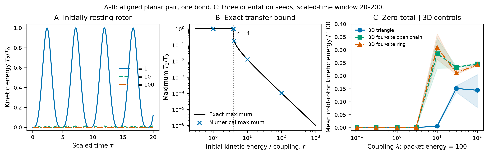
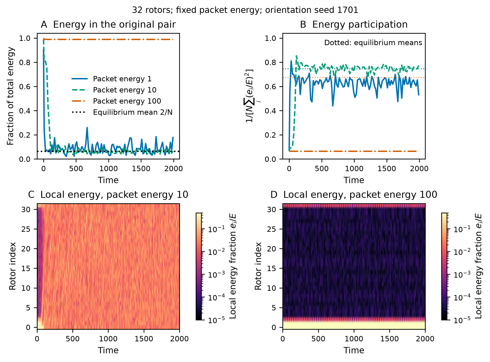
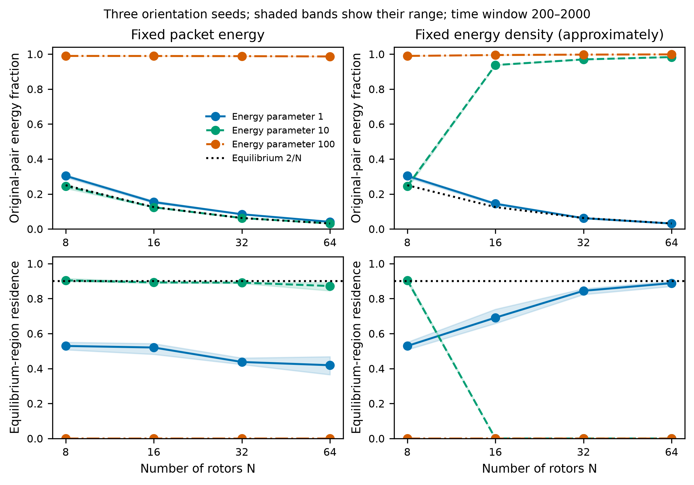
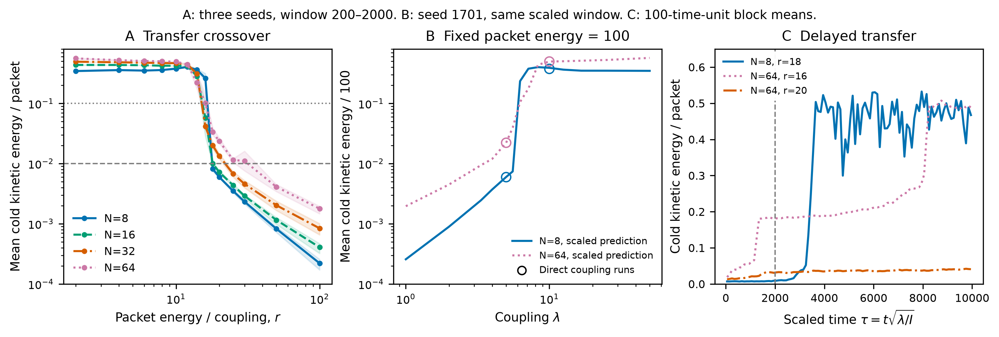

# Energy transfer and equilibration in interacting rotors

*Classical results and the quantum continuation, October 16, 2026.*

Consider a collection of interacting rotors whose energy initially resides in one or a few of them. Does the energy remain concentrated, or does it spread until most rotors participate in the motion? If it spreads, does the system spend most of its time near the distribution predicted by statistical mechanics? These questions distinguish energy transfer from equilibration. A system can exchange energy without approaching an equilibrium distribution, and a system close to equilibrium can still fluctuate and eventually return near its initial state.

The rotor model makes these questions concrete. Each rotor has a kinetic energy proportional to the square of its angular momentum, while interactions exert torques that can change that energy. We can vary the number of rotors, the initial packet energy and the coupling strength independently, then follow the resulting redistribution. The calculations show substantial spreading for moderate packets and strongly suppressed transfer for faster initial rotors. Longer evolution reveals that some apparently trapped packets eventually release their energy. The essential issue is therefore the relation between the interaction and redistribution timescales.

We begin with the mechanical model and a two-rotor example whose energy exchange can be understood exactly. We then turn to three-dimensional systems with zero total angular momentum, the larger-ring equilibrium comparison, and the coupling scan. The last section formulates the quantum problem that these classical results motivate. Numerical methods and the earlier face-channel calculation are collected in the appendices.

## How the interaction transfers energy

A three-dimensional linear rotor has a unit orientation vector $\mathbf q_i$ and angular momentum $\mathbf J_i$ satisfying

$$
|\mathbf q_i|=1,\qquad \mathbf q_i\cdot\mathbf J_i=0.
$$

The second condition says that its angular momentum is perpendicular to its orientation. For identical moments of inertia $I$, we take

$$
H=\sum_i\frac{\mathbf J_i^2}{2I}
+\lambda\sum_{\langle ij\rangle}(1-\mathbf q_i\cdot\mathbf q_j).
$$

The graph specifies which rotors interact; each undirected bond is counted once. Positive $\lambda$ favors aligned orientations. Most of the numerical study uses a nearest-neighbor ring, with $\mathbf q_N=\mathbf q_0$, so each rotor has two neighbors regardless of system size. All numerical rotor studies reported here have $I=1$. The first ring calculation also fixes $\lambda=1$; subsequent calculations vary the coupling explicitly.

On the ring, the equations of motion are

$$
\dot{\mathbf q}_i=\frac{\mathbf J_i}{I}\times\mathbf q_i,
\qquad
\dot{\mathbf J}_i=\lambda\mathbf q_i\times
(\mathbf q_{i-1}+\mathbf q_{i+1}).
$$

The first equation rotates the orientation about the angular momentum. The second is the torque exerted by the neighboring rotors. It changes the individual kinetic energy according to

$$
\frac{d}{dt}\frac{\mathbf J_i^2}{2I}
=\frac{\mathbf J_i}{I}\cdot\dot{\mathbf J}_i.
$$

Each bond supplies equal and opposite torques to its endpoints. Total angular momentum is conserved, and energy lost by one part of the system appears elsewhere as kinetic or interaction energy.

The orientation dependence is important. An interaction constructed only from $\mathbf J_i\cdot\mathbf J_j$ preserves each local Casimir $\mathbf J_i^2$ and cannot redistribute these kinetic energies. Our model includes the variables conjugate to angular momentum, so the local magnitudes can change. It conserves total angular momentum, but does not conserve the area analogue $\sum_i|\mathbf J_i|$. Its connection to face-channel dynamics is discussed in Appendix C.

## Two rotors already distinguish exchange from trapping

Before studying a large system, consider two rotors restricted to a plane, coupled by a single bond:

$$
H=\frac{p_1^2+p_2^2}{2I}
+\lambda[1-\cos(\theta_1-\theta_2)].
$$

This planar motion is an invariant subspace of the three-dimensional model. Introduce the collective and relative variables

$$
\Theta=\frac{\theta_1+\theta_2}{2},\qquad
\phi=\theta_1-\theta_2,\qquad
P=p_1+p_2,\qquad p=\frac{p_1-p_2}{2}.
$$

They are canonical because $p_1d\theta_1+p_2d\theta_2=P d\Theta+p d\phi$. The Hamiltonian separates:

$$
H=\frac{P^2}{4I}
+\underbrace{\frac{p^2}{I}+\lambda(1-\cos\phi)}_{H_{\rm rel}}.
$$

The collective momentum $P$ is constant. The relative motion is a pendulum,

$$
\dot\phi=\frac{2p}{I},\qquad
\dot p=-\lambda\sin\phi,
$$

whose potential barrier has height $2\lambda$.

Start with aligned rotors, $\phi(0)=0$, and put all the kinetic energy into the first: $p_1(0)=p_0>0$, $p_2(0)=0$. Writing $T_0=p_0^2/(2I)$, the collective and relative energies are both $T_0/2$. The character of the relative motion therefore changes at

$$
T_0=4\lambda.
$$

Below this value, the relative pendulum oscillates and its momentum reverses sign. When it returns to $\phi=0$ with $p=-p_0/2$, the original velocities have exchanged: rotor 1 is at rest and rotor 2 carries the kinetic energy. The exchange then reverses. Complete transfer is possible without equilibration.

Above this value, the relative motion keeps rotating. Its momentum cannot reach zero, and the initially fast rotor cannot become the slower one. At the maximum of the interaction potential,

$$
p_{\min}=\frac{p_0}{2}\sqrt{1-\frac{4\lambda}{T_0}}.
$$

Since $p_2=P/2-p$, the maximum kinetic-energy fraction acquired by rotor 2 is

$$
\boxed{
\frac{T_{2,\max}}{T_0}
=\left[\frac{1-\sqrt{1-4\lambda/T_0}}{2}\right]^2,
\qquad T_0>4\lambda.
}
$$

For a very energetic initial rotor this becomes

$$
\frac{T_{2,\max}}{T_0}\sim
\left(\frac{\lambda}{T_0}\right)^2.
$$

Thus a nonzero interaction can produce very little exchange. The fast rotor repeatedly changes the direction of the torque before its partner responds appreciably. The pendulum picture makes this averaging argument exact for the specified planar preparation.

| $T_0/\lambda$ | Motion | Maximum receiver kinetic energy / initial kinetic energy |
|---|---|---:|
| 1 | Libration | 100% |
| 3.9 | Libration | 100% |
| 4.1 | Rotation | 17.8011% |
| 10 | Rotation | 1.27017% |
| 100 | Rotation | 0.0102051% |

At the separating trajectory, $T_0=4\lambda$, the transferred fraction approaches 25% only asymptotically. Approaching the boundary from below, complete exchange takes increasingly long. A finite observation interval must therefore be distinguished from an all-time transfer bound. Different initial relative angles change $H_{\rm rel}$ and hence the boundary; the table uses aligned initial orientations throughout.

## From a pair to a closed three-dimensional system

The planar benchmark has nonzero total angular momentum. If two equal-inertia rotors instead satisfy $\mathbf J_1+\mathbf J_2=0$, their kinetic energies must be equal at every time. One fast rotor and one resting rotor cannot satisfy that constraint. To retain zero total angular momentum while studying redistribution, we put opposite momenta in an energetic pair and add initially resting rotors.

A three-rotor example has a further useful lesson. On a triangle, identical planar initial orientations with momenta $+p,-p,0$ leave the third rotor stationary: reflection symmetry makes its two neighbor torques cancel. An enlarged state space alone does not guarantee that the dynamics explores it. We use small three-dimensional orientation perturbations to avoid this exact invariant preparation.

The generic controls use a triangle, a four-rotor open chain and a four-rotor ring. The original pair has combined initial kinetic energy 100, while the other rotors start with zero kinetic energy. Three orientation seeds and seven couplings give 63 three-dimensional runs. In the open four-rotor chain, the initially resting pair acquires the following mean kinetic energy, divided by the initial packet energy:

| $\lambda$ | Mean over three orientation seeds, $\tau\in[20,200]$ |
|---:|---:|
| 0.1 | 0.000324% |
| 1 | 0.01033% |
| 3 | 0.08955% |
| 10 | 28.53% |
| 30 | 23.34% |
| 100 | 24.60% |

These averages use scaled times $\tau\in[20,200]$, where $\tau=t\sqrt{\lambda/I}$. Stronger coupling permits much more exchange, although the response is not monotonic throughout the stronger-coupling region. A many-rotor graph does not have a separately conserved relative pendulum energy for each bond, so the exact two-rotor bound cannot be applied to it.

*Left: kinetic energy received by an initially resting planar rotor. Middle: the exact maximum transfer and the numerical result. Right: zero-total-angular-momentum three-dimensional controls at fixed initial packet kinetic energy 100; bands span three orientation seeds. The planar bound and the three-dimensional measurements describe different preparations. [Vector PDF](../figures/t11-few-rotors/few-rotor-transfer.pdf).*

The [few-rotor note](few-rotor-energy-transfer.md) contains the detailed mechanism checks. This example also connects to the wider literature: Fermi–Pasta–Ulam–Tsingou dynamics illustrates delayed equipartition and recurrence in a nonlinear classical system, while rotor studies examine long-lived energy concentration and slow release. These are mechanisms to investigate, rather than a guarantee that every interacting system equilibrates. [Onorato et al.](https://arxiv.org/abs/1402.1603), [Cuneo, Eckmann and Wayne](https://arxiv.org/abs/1702.06464).

## Preparing energy packets in a larger ring

For the larger systems we use $N=8,16,32,64$ rotors. Their initial orientations are

$$
\mathbf q_i=
\frac{\mathbf e_z+0.05\boldsymbol\eta_i}
{|\mathbf e_z+0.05\boldsymbol\eta_i|},
\qquad \boldsymbol\eta_i\sim\mathcal N(0,I_3),
$$

with seeds 1701–1703. Only neighboring rotors 0 and 1 initially move:

$$
\mathbf J_0=-\mathbf J_1=
\sqrt{I E_{\rm packet}}\,
\frac{\mathbf q_0\times\mathbf q_1}
{|\mathbf q_0\times\mathbf q_1|}.
$$

Their combined kinetic energy is $E_{\rm packet}$, and both tangency and zero total angular momentum hold. The small generic orientation perturbations permit motion beyond a perfectly aligned or planar subspace.

We first hold the packet energy fixed as rotors are added, using $E_{\rm packet}=1,10,100$ at $\lambda=1$. This asks whether the same localized excitation can spread across a larger system. A second comparison holds the packet contribution to energy density fixed, using $E_{\rm packet}=aN/8$ with $a=1,10,100$. The latter makes the initially moving pair faster as the system grows; it changes both system size and the local excitation.

Initial potential energy is additional. It ranges from 0.010–0.040 at $N=8$ and 0.268–0.377 at $N=64$. This background is especially significant for the weakest fixed packet. We therefore use the actual conserved total energy when constructing each equilibrium reference. The first scan has 72 runs, including nine duplicate $N=8$ controls shared by the two comparisons: 63 unique initial dynamical problems.

## How to recognize redistribution and equilibration

Give each rotor half the potential energy of each adjoining bond:

$$
e_i=\frac{\mathbf J_i^2}{2I}
+\frac\lambda2(1-\mathbf q_{i-1}\cdot\mathbf q_i)
+\frac\lambda2(1-\mathbf q_i\cdot\mathbf q_{i+1}).
$$

These nonnegative local energies sum to $E=H$. We follow the original-pair fraction $(e_0+e_1)/E$ and the normalized energy participation

$$
f_{\rm part}=\frac{1}{N\sum_i(e_i/E)^2}.
$$

If energy is shared equally among all rotors at an instant, $f_{\rm part}=1$. A thermally fluctuating system generally has a smaller mean participation. Equal instantaneous rotor energies are not the definition of equilibrium.

The reference is the microcanonical ensemble at the same energy and total angular momentum zero. Translation symmetry gives

$$
\left\langle\frac{e_0+e_1}{E}\right\rangle_{\rm eq}
=\frac2N.
$$

We compare the energy fractions and their distributions with independently sampled equilibrium values. For a joint residence diagnostic, take the maximum absolute deviation of the original-pair fraction, total kinetic fraction and participation fraction from their equilibrium means. The 90th percentile of that distance in the equilibrium samples defines a typical equilibrium region. A trajectory distributed like that ensemble would spend approximately 90% of its samples inside the region. This compares fluctuations as well as averages. Appendix A gives the constrained sampling measure.

At fixed packet energy 10, the measured late-time original-pair fraction closely follows $2/N$:

| Rotors | Measured fraction, mean over three seeds | Equilibrium mean | Residence in the 90% equilibrium region |
|---|---:|---:|---:|
| 8 | 0.245 | 0.250 | 90.4% |
| 16 | 0.124 | 0.125 | 89.3% |
| 32 | 0.063 | 0.0625 | 89.1% |
| 64 | 0.032 | 0.03125 | 87.2% |

The window is $t\in[200,2000]$, averaged over three seeds. The original-pair distribution distances from the equilibrium reference are also small: the mean Kolmogorov–Smirnov distances are 0.055, 0.035, 0.022 and 0.042 for increasing $N$. These observables support equilibration over the sampled interval.

*One 32-rotor preparation at fixed packet energy. Upper curves use 20-time-unit block means; dotted lines mark equilibrium means. Lower panels show local-energy fractions on a logarithmic color scale. Packet energy 10 spreads, while packet energy 100 remains concentrated through time 2,000. [Vector PDF](../figures/t11-classical-rotors/rotor-dynamics.pdf).*

At packet energy 100, the original pair retains 98.7–99.0% of local total energy over the same late window, across all four sizes. Its residence in the sampled equilibrium region is zero. Increasing the available number of rotors does not overcome the observed trapping within that interval.

*Late-time averages and equilibrium-region residence. Bands show the range over three orientation seeds. Fixed-density preparation increases the energy concentrated in the original pair as $N$ grows. [Vector PDF](../figures/t11-classical-rotors/rotor-scaling.pdf).*

For the density comparison with $a=10$, packet energies are 10, 20, 40 and 80. The original-pair late-time local-energy fractions are 0.245, 0.937, 0.970 and 0.983. The change from spreading to trapping therefore cannot be attributed to rotor count alone: the pair becomes faster at the same time. At the other end, the weak fixed packet of energy 1 spreads but has less equilibrium-like diagnostics, with residence falling from about 53% to 42% across the tested sizes. The initial potential background and nearly harmonic low-energy motion both matter in interpreting this comparison.

## Coupling strength sets the energy scale

The two-rotor calculation suggests that the ratio of packet energy to coupling should organize the larger-system behavior. Define

$$
r=\frac{E_{\rm packet}}\lambda,\qquad
\tau=t\sqrt{\lambda/I},\qquad
\boldsymbol\ell_i=\frac{\mathbf J_i}{\sqrt{I\lambda}}.
$$

Then

$$
\frac H\lambda=
\sum_i\frac{\boldsymbol\ell_i^2}{2}
+\sum_i(1-\mathbf q_i\cdot\mathbf q_{i+1}).
$$

At fixed graph and initial orientation labels, the dimensionless dynamics is specified by the scaled momenta, or by $r$ for our fixed packet prescription. The coupling can be removed from the equations by changing energy and time units. Consequently, an operational energy-transfer crossover at matched scaled time has the form

$$
E_{{\rm packet},c}
=\lambda\,r_c(N,\tau,\text{preparation},\text{criterion}).
$$

The linear coupling factor follows exactly from this rescaling. The numerical questions are the coefficient, its dependence on size and initial state, and its evolution with observation time. At a fixed physical time, coupling also changes the amount of scaled evolution:

$$
E_{{\rm packet},c}(\lambda,t)
=\lambda\,r_c\!\left(N,t\sqrt{\lambda/I},\ldots\right).
$$

We scanned 14 ratios from 2 to 100 at all four sizes and three seeds, giving 168 primary trajectories through $\tau=2000$. Another 29 histories check explicit physical couplings, smaller steps and longer observation windows. In this scan the transfer observable is

$$
F_{\rm cold}(\tau)=
\frac{\sum_{i\geq2}\mathbf J_i(\tau)^2/(2I)}{E_{\rm packet}}.
$$

This counts kinetic energy acquired by initially resting rotors. It differs from the local-total-energy fraction used above, which includes a share of potential energy even before a rotor moves.

The main transfer drop is relatively narrow, but its small-transfer tail extends to higher ratios in larger rings. The predefined diagnostics call a mean fraction of at least 10% significant and at most 1% suppressed. A secondary summary locates the half-response drop, relative to each seed's mean response at $r=2,4,6,8,10$. Its grid brackets over $\tau\in[200,2000]$ are:

| Rotors | Half-response crossover bracket, envelope over seeds | First persistently below 1% transfer, range over seeds |
|---:|---:|---:|
| 8 | $16<r_c<18$ | $r=18$ |
| 16 | $14<r_c<16$ | $r=18$–20 |
| 32 | $14<r_c<16$ | $r=25$ |
| 64 | $12<r_c<16$ | $r=30$–50 |

The half-response summary was added after inspection to distinguish the main drop from the tail; it is not a fitted critical point. For 32 rotors it places the half-response scale between approximately $14\lambda$ and $16\lambda$ in this window. A more stringent 1% criterion gives a different operational scale. The two-rotor value $T_0=4\lambda$ is not expected to coincide with either: its preparation and constants of motion differ from those of the zero-angular-momentum ring.

Directly increasing coupling at fixed initial packet kinetic energy 100 confirms the effect. For seed 1701, using the same physical interval $t=200$ to approximately 2000:

| Rotors | $\lambda=1$ | $\lambda=5$ | $\lambda=10$ |
|---:|---:|---:|---:|
| 8 | 0.0257% | 0.632% | 37.8% |
| 64 | 0.196% | 3.03% | 49.6% |

The end times differ from 2,000 by less than 0.061 because output times lie on a scaled grid. Stronger coupling turns a weakly exchanging packet into a substantially redistributing one without changing its initial momenta. This trend is present with a common physical clock as well as with matched scaled time.

## Apparent trapping can end in delayed release

The eight-rotor case at $r=18$ makes the role of time especially clear. Through $\tau=2000$, all three orientation seeds have a mean cold kinetic fraction below 1%. Extending the same preparations to $\tau=10000$ gives means over $[200,10000]$ of 31.6%, 29.0% and 30.1%. A smaller-step repetition gives 30.6% for the first seed.

In that first trajectory, the mean is about 0.74% over $[0,2000)$, 15.1% over $[2000,4000)$ and 45.7% over $[4000,6000)$. No noise or driving is added during evolution. A state that looked trapped in the shorter run begins transferring substantial energy later.

*Left: the transfer crossover, averaged over scaled times 200–2,000; bands span three seeds. Middle: direct coupling tests at fixed packet energy 100 compared with their dimensionless counterparts. Right: 100-time-unit block means show delayed release; the gray line marks the end of the initial observation window. [Vector PDF](../figures/t11-rotor-coupling/coupling-crossover.pdf).*

The larger ring has delayed behavior too. At $N=64,r=16$, the first seed's mean transfer rises from 10.6% through $\tau=2000$ to 24.4% through 10,000. The smaller-step longer run gives 15.4%, showing that the detailed release timing is less well determined than the qualitative occurrence of transfer. At $N=64,r=20$, the longer mean remains only 3.4%.

The classical results therefore support a picture of interaction-dependent redistribution on widely separated timescales. Fast rotation can suppress exchange for a long interval, while additional degrees of freedom permit later leakage and release. The location of an apparent cutoff depends on the transfer criterion and the observation time. Whether every high-energy preparation ultimately equilibrates remains a further question. The [coupling note](rotor-coupling-crossover.md) retains the complete threshold and time-control analysis.

## The quantum problem

The next calculation quantizes the same mechanical model. A three-dimensional linear rotor has

$$
\mathcal H_i=L^2(S^2),\qquad
\hat{\mathbf J}_i^2|j,m\rangle
=\hbar^2j(j+1)|j,m\rangle,
\qquad j=0,1,2,\ldots.
$$

For several rotors,

$$
\hat H=\sum_i\frac{\hat{\mathbf J}_i^2}{2I}
+\lambda\sum_{\langle ij\rangle}
(1-\hat{\mathbf q}_i\cdot\hat{\mathbf q}_j).
$$

The orientation interaction connects different local angular-momentum sectors, allowing the kinetic energies to change. Rotational invariance preserves total angular momentum, so the three-dimensional study can retain the total-angular-momentum-zero sector. A fixed-spin Heisenberg model would preserve every local $j$ and would not implement this energy-transfer problem.

The planar pair supplies a first benchmark. Fixing total momentum $P=\hbar M$, with integer $M$, leaves the relative Hamiltonian

$$
\hat H_{\rm rel}
=-\frac{\hbar^2}{I}\frac{\partial^2}{\partial\phi^2}
+\lambda(1-\cos\phi).
$$

Single-valuedness in the two original angles requires

$$
\psi(\phi+2\pi)=(-1)^M\psi(\phi).
$$

The relative wavefunction is periodic for even $M$ and antiperiodic for odd $M$. In the original momentum basis $|m,M-m\rangle$, the full pair Hamiltonian has diagonal entries

$$
H_{mm}=\frac{\hbar^2}{2I}\left[m^2+(M-m)^2\right]+\lambda,
$$

and nearest off-diagonal entries $H_{m\pm1,m}=-\lambda/2$. This gives a direct numerical starting point once the momentum cutoff and initial wave packet are chosen.

Classically, high-energy relative motion remains on one rotating branch. Quantum mixing can connect opposite rotation states. If a prepared packet is dominated by an isolated pair of split levels, their relative phase changes by $\pi$ on the timescale

$$
t_{\rm exchange}\sim\frac{\pi\hbar}{\Delta E}.
$$

A very small splitting can therefore produce a very long exchange time. Coupled-rotor studies illustrate this dynamical tunneling mechanism, although the splitting and overlaps for our preparation must be calculated explicitly. [Dorignac and Flach](https://arxiv.org/abs/cond-mat/0112168).

Quantum dynamics has an additional dimensionless parameter,

$$
\epsilon=\frac{\hbar}{\sqrt{I\lambda}}.
$$

Writing the wavefunction in orientation coordinates gives

$$
i\epsilon\,\partial_\tau\Psi=
\left[-\frac{\epsilon^2}{2}\sum_i\Delta_{S_i^2}
+\sum_{\langle ij\rangle}(1-\mathbf q_i\cdot\mathbf q_j)\right]\Psi.
$$

Unlike the classical equations, the quantum problem depends on $\epsilon$ as well as the initial energy relative to coupling. Increasing $\lambda$ at fixed $I$ and $\hbar$ changes both parameters. A classical comparison should vary $\epsilon$ while matching the preparation's orientation and momentum distributions. A sharp angular-momentum state has delocalized orientation and is not the quantum counterpart of a single localized classical configuration.

The physical observables remain the local kinetic-energy distributions and their transfer between rotors. Quantum evolution also generates entanglement: a globally pure state can have mixed reduced states for individual rotors or groups of rotors. Their entropy and their agreement with equilibrium predictions can be studied alongside energy sharing. The first step is the planar-pair spectrum and exchange dynamics, followed by three or four three-dimensional rotors at total angular momentum zero. This section specifies the quantum continuation; the results and figures above are classical.

## Appendix A: the equilibrium measure

At fixed orientations, angular momenta lie in a $2N$-dimensional tangent space. The three conditions $\sum_i\mathbf J_i=0$ leave $2N-3$ independent directions for generic configurations. Define

$$
B(\mathbf q)=\sum_i
\left(I_3-\mathbf q_i\mathbf q_i^{\mathsf T}\right).
$$

Integrating the momentum and energy delta functions gives an orientation weight

$$
w_E(\mathbf q)\propto
\frac{[E-V(\mathbf q)]^{N-5/2}}{\sqrt{\det B(\mathbf q)}}\,
\mathbf1_{V<E}
$$

relative to the product of spherical area measures. The power comes from integrating over the constrained momentum sphere; the determinant accounts for conditioning tangent momenta on zero total angular momentum. Exactly collinear configurations make $B$ singular, so this formula is used on generic configurations.

We sample orientations with isotropic Gaussian proposals followed by normalization, adapting the width only during burn-in. At each retained configuration, independent tangent Gaussian momenta $\mathbf u_i$ are projected onto zero total angular momentum:

$$
P_i=I_3-\mathbf q_i\mathbf q_i^{\mathsf T},\qquad
\widetilde{\mathbf J}_i=
\mathbf u_i-P_iB^{-1}\sum_j\mathbf u_j.
$$

A common rescaling then sets their kinetic energy to $E-V$. This produces a uniform direction on the constrained momentum sphere. Each reference uses two independently seeded chains, 4,000 burn-in sweeps and 4,000 retained samples per chain separated by four sweeps. Split-$\widehat R$ is at most 1.0033 for the readouts used. Block errors and acceptance rates are saved. These diagnose the sampled observables; they do not prove exploration of every dynamically accessible region.

## Appendix B: numerical methods and evidence

The classical integrator alternates exact potential kicks with exact free-rotor rotations in a symmetric kick–drift–kick step. The drift uses Rodrigues' rotation formula. No constraint projection is applied during evolution. Orientation lengths, tangency and total angular momentum are preserved up to rounding; energy has the bounded error of the second-order splitting.

For the initial $\lambda=1$ ring scan, production runs end at $t=2000$ with output spacing 0.5 and

$$
\Delta t\leq\frac{0.01}{\sqrt{\max(1,E_{\rm packet}/10)}},
$$

rounded to divide the output spacing. Coupling scans scale the physical step and output interval consistently with $\tau$. Faster packets use finer steps. The exclusion of the first 200 time units is an analysis convention, not a measured relaxation time.

The initial ring study has ten full-duration half-step controls. Its maximum relative energy drift is $7.05\times10^{-5}$, total angular-momentum norm stays below $7.35\times10^{-12}$, orientation error below $3.41\times10^{-13}$ and tangency error below $1.26\times10^{-13}$. The largest late-time original-pair mean change on refinement is 0.0197, and the largest equilibrium-region residence change is 0.020. Independent saved-array checks cover 12,399,912 scalar quantities.

The few-rotor study has 14 planar-pair runs, 63 generic three-dimensional runs and six half-step controls, together with independent scalar-pendulum, exact-symmetry and parameter-scaling checks. Maximum relative drift in the generic controls is $5.60\times10^{-6}$. The exact planar transfer bounds agree with the numerical maxima.

The larger coupling study has 168 primary runs and 29 controls, with 409 saved window summaries. Its maximum relative drift is $7.05\times10^{-5}$. Independent audits check 33,916,477 scalar quantities, with local-energy sum error below $1.43\times10^{-13}$ and endpoint Hamiltonian agreement within $8.53\times10^{-14}$. All 56 regression tests pass, including independent ODE, reversal, general-graph and physical-unit comparisons.

Small conservation errors do not fix long-time release times precisely. Near the crossover, short-window half-step transfer means change by as much as 3.23 percentage points; one case crosses the arbitrary 10% threshold. Longer runs also show timing sensitivity. We therefore report grid brackets, seed ranges and observation windows. The three orientation seeds and the equal-and-opposite neighboring packet do not survey all possible preparations. No permanent localization boundary or universal equilibration claim follows from these data.

The numerical records are [the initial ring study](../results/t11-classical-rotors/README.md), [the few-rotor benchmark](../results/t11-few-rotors/README.md) and [the coupling scan](../results/t11-rotor-coupling/README.md). They preserve protocols, arrays, source hashes and detailed validation. All four figures have vector PDF and 300-dpi PNG versions. No quantum rotor evolution has yet been run.

## Appendix C: why we turned from face channels to rotors

The original question concerned an FL tetrahedron embedded in a larger set of face channels. Free hopping activates initially empty channels but has a short exact recurrence on the uniform complete graph. Adding available channels and increasing area at a fixed channel count are different changes of the system. Before reconstructing geometry, we chose to understand energy redistribution itself. The [face-energy note](face-energy-equipartition.md) retains that starting point and its many-body precedents.

An initial exact singlet-sector pilot added onsite repulsion to hopping, using $t_{ij}=1/(L-1)$. At $K=3$, the regular-input residence percentages near the exact dephased reference were:

| Channels | U=0 | U=1 | U=5 |
|---:|---:|---:|---:|
| 4 | 19.0% | 66.8% | 76.1% |
| 5 | 0.0% | 50.3% | 76.7% |
| 6 | 0.0% | 50.1% | 90.3% |

The time window is $[20,200]$, and the readout-distance tolerance is 0.05. The reference retains coherences within degenerate energy subspaces. Changing the input phases changes the result, and at $K=2$ at most four channels can be occupied simultaneously. This small-area pilot checks the numerical machinery; it does not answer the large-tetrahedron question. Its [result report](../results/t11-equilibration/README.md) records all 42 trajectories and independent checks.

The exact singlet-space dimension explains why simply increasing area in a dense calculation becomes expensive:

$$
d_{L,K}=\frac1{K+1}
\binom{K+L-1}{K}\binom{K+L-2}{K}.
$$

| Total area K | 4 channels | 5 channels | 6 channels |
|---:|---:|---:|---:|
| 3 | 50 | 175 | 490 |
| 5 | 196 | 1,176 | 5,292 |
| 10 | 1,716 | 26,026 | 273,273 |
| 20 | 19,481 | 896,126 | 26,883,780 |

At $K=10,L=6$, one dense complex128 matrix alone requires approximately 1.195 TB. This growth belongs to the exact quantum representation, not to the classical rotor variables.

A separate possible large-area route is FL variational dynamics. For normalized spinor labels satisfying $\sum_i z_i z_i^\dagger=I_2$, put $p_i=z_i^\dagger z_i$. The coherent-state expectations are

$$
\langle E_{ij}\rangle=Kz_i^\dagger z_j,
\qquad
\langle n_i(n_i-1)\rangle=K(K-1)p_i^2.
$$

For hopping plus onsite repulsion, the variational energy is

$$
\mathcal H_K=
K\sum_{ij}h_{ij}z_i^\dagger z_j
+\frac{UK(K-1)}2\sum_i p_i^2,
$$

and the time-dependent variational equations, in a convenient gauge, are

$$
i\dot z_i=\sum_jh_{ij}z_j+U(K-1)p_i z_i.
$$

Quadratic hopping preserves the FL family exactly. The interacting equations constrain evolution to that family and must be checked against the larger quantum dynamics. They were discussed, not implemented at large area, in this session. This coherent-state phase space and the mechanical rotor phase space are distinct. The rotor study isolates the energy-transfer mechanism; specifying an interaction that transfers the relevant local energy while respecting intertwiner constraints is the next connection to make.
