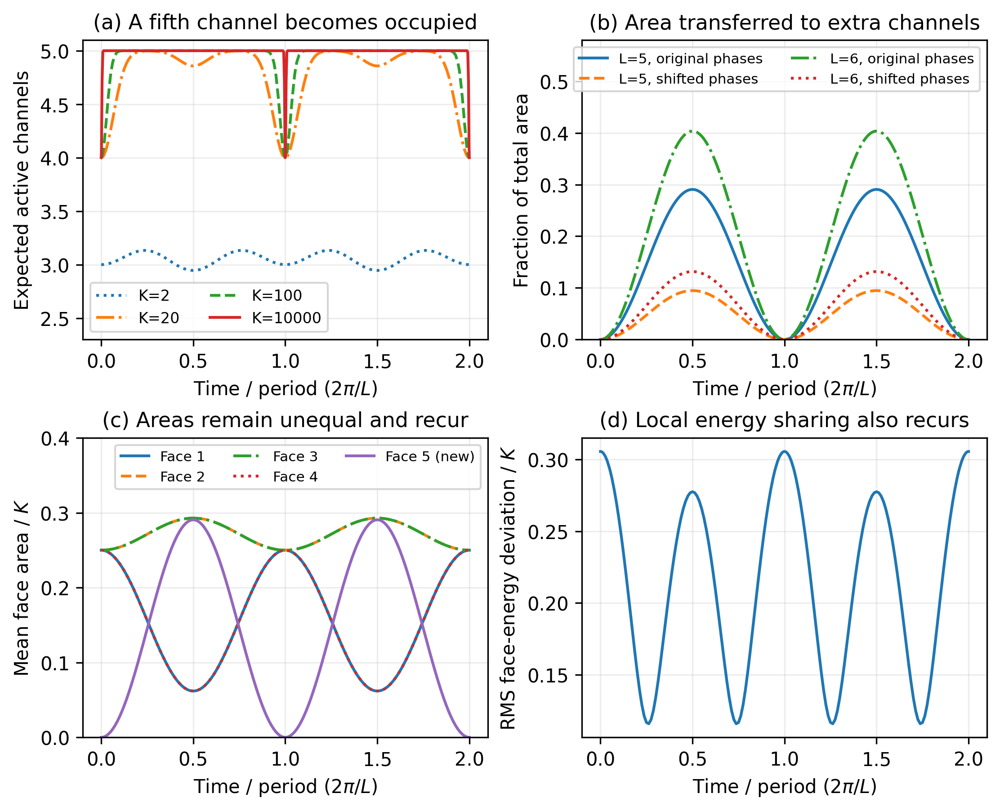

# Can a large tetrahedron spread its area over more faces?

*Free-hopping control, interaction assessment and next investigation, October 16, 2026.*

The user's question is whether a tetrahedron with large face areas evolves
toward a polyhedron with more, smaller faces, and whether this can be understood
as energy sharing. A first exact free-hopping control is now calculated below.
The interacting model remains a proposed extension. The control identifies
what the existing code can already establish and the additional ingredients
needed for a conclusion about thermal equilibration.

## What can change in the present models?

On four Schwinger face channels, hopping can redistribute area, but the state
has no fifth channel to populate. The existing full fixed-number builder
accepts arbitrary graphs and numbers of available channels. The four/five-site
singlet comparison and variable-active-face catalogue provide additional
checks. These tools already distinguish an available channel from a face with
nonzero spin.

An initial four-face FL tetrahedron can be embedded into five or six channels
by placing the extra ones in the vacuum. The existing generators

$$
E_{ij}=a_i^\dagger a_j+b_i^\dagger b_j
$$

commute with total area and global SU(2) closure. A coupling to an initially
empty channel can therefore populate it while reducing occupation elsewhere.
This is a concrete mechanism for increasing the number of active faces at
fixed total area. It operates within a declared maximum valence; genuine
changes of the number of available legs require a larger direct-sum Hilbert
space and specified maps between valences.

Nonzero spin alone does not guarantee a distinct face of a nondegenerate
classical polyhedron. Relative normals, degeneracy and positive volume should
accompany the active-face count when interpreting a semiclassical state.

## A large-area control without constructing the huge Hilbert space

For a purely quadratic hopping Hamiltonian

$$
H_0=\sum_{ij}h_{ij}E_{ij},\qquad h=h^\dagger,
$$

the fixed-area FL family is preserved by the U(L) action. Its spinor matrix
evolves as $Z(t)=e^{-iht/\hbar}Z(0)$. After normalizing closure so that
$Z^\dagger Z=I_2$, the total area-K state's face-area means are

$$
\langle A_i(t)\rangle=\frac K2\|z_i(t)\|^2,
\qquad \sum_i\|z_i(t)\|^2=2.
$$

The one-face occupation marginal is binomial in K with parameter
$p_i=\|z_i\|^2$, so

$$
\Pr(A_i=0)=(1-p_i)^K,\qquad
\langle N_{\rm active}\rangle=\sum_i[1-(1-p_i)^K].
$$

The empty-face probability also follows from the FL norm: removing row i
changes the norm determinant by
$\det(I_2-z_i^\dagger z_i)=1-\|z_i\|^2$, raised to K.
Thus the free-hopping study reaches large K by propagating an L-by-2 spinor
matrix. The implementation compares these formulas against the existing
occupation-space state constructor and sparse evolution at small K, including
phase and normalization conventions.

This control would establish possible face activation and recurrence. Pure
quadratic hopping supplies coherent, integrable dynamics; it does not by
itself demonstrate approach to thermal equilibrium.

## First numerical control: activation with periodic return

We implemented the exact U(L) evolution above for L=5,6, total linear areas
K=2,20,100,1000,10000, and two choices of initial face phases. All initial
nonzero face spinors describe the same regular tetrahedral normals and equal
mean areas; extra rows are vacuum. The Hamiltonian is the existing free
complete-graph hopping, $H_0=-\sum_{i<j}(E_{ij}+E_{ji})$, with hopping=1,
$\hbar=1$ and onsite repulsion U=0. No F/J interaction was added.

The complete-graph single-particle spectrum has two eigenvalues, so the state
recurs up to an overall phase after $2\pi/L$. We sample two periods with
additional resolution near returns. Direct sparse full-occupation evolution
at K=1,2 verifies the coherent-state action, individual area means, variances,
empty-face probabilities and energy; it does not use the spinor propagator.
All 360 checks pass, with maximum residual $1.9\times10^{-11}$. The existing
46 regression tests also pass after extending the shared FL/spinor library.

At K=10000 the starting mean areas are 2500 on each original face. In the
five-channel baseline, the extra channel reaches mean area 2906.3945, or
29.0639% of the total. At that time the five means are approximately

$$
(618.70,\;2928.10,\;2928.10,\;618.70,\;2906.39).
$$

Thus activating a fifth face need not make every face smaller or equally
sized. With shifted initial phases the peak new-area fraction is 9.4680%.
Those phase choices also change the conserved initial hopping energy, so this
comparison demonstrates sensitivity to additional state data, rather than a
fixed-energy thermalization test. The mean local-energy differences also
oscillate and recur.

**Figure 1.** Exact FL hopping controls. Panel (a) distinguishes large-area
activation from small-K occupation fluctuations. Even the starting four-face
FL label can have vacuum-face weight at small K. Panel (b) follows the fraction
of area on additional channels for both phase choices. Panels (c) and (d)
show the five-channel baseline at K=10000; faces 1/4 and 2/3 have coincident
curves. Energies split each hopping bond equally between its endpoints.
[Vector PDF](../figures/fl-face-activation/face_activation_control.pdf).

The six-channel symmetric model activates both extra channels, reaching
40.3666% combined new area in the baseline. However, their evolved spinor
rows coincide, so they have the same classical normal. Merging repeated
normal directions leaves at most five distinct facets. The five-channel run
has five distinct directions at generic non-return times. In all controls,
the face vectors close and span three dimensions; their closure residual is
below $1.2\times10^{-15}$. These are checks of classical FL input labels,
not vanishing quantum flux one-point functions, and no metric volume was
reconstructed in this control.

This is evidence for allowed face activation and coherent recurrence, with no
tendency toward permanent equalization in the tested free model. It directly
motivates the interacting extension below. The [result report](../results/fl-face-activation/README.md)
contains fixed settings, source hashes, numerical tables and verification.

## How this connects to many-body equilibration

The user's phase-space intuition is sound: a return to the initial state does
not rule out spending most of a long observation window near equilibrium.
Recurrence and equilibration answer different questions. For a finite isolated
system, the practical test is whether selected observables stay near values
predicted by an ensemble with the same conserved energy, total area and
closure, and what fraction of the observation time they do so. Their time
averages and fluctuations, dependence on the initial state, and return times
should be reported together. A large accessible Hilbert space alone does not
guarantee that the dynamics explores it: integrability, symmetries and
additional conserved quantities can constrain the motion.

This distinction is familiar in other many-body settings. The classical
Fermi-Pasta-Ulam-Tsingou chain famously showed energy returning to initially
excited modes; later work describes how nonlinear resonances can drive
equipartition on much longer timescales [Onorato et al.](https://arxiv.org/abs/1402.1603).
For quantum systems, the eigenstate thermalization hypothesis explains how
local observables in suitable interacting systems can agree with statistical
mechanics after unitary evolution [Rigol, Dunjko and Olshanii](https://www.nature.com/articles/nature06838).
Experiments on isolated Bose gases have measured relaxation toward equilibrium
[Trotzky et al.](https://www.nature.com/articles/nphys2232), while the nearly
integrable quantum Newton's cradle retained strong memory of its initial
motion [Kinoshita, Wenger and Weiss](https://doi.org/10.1038/nature04693).
Entanglement growth and local thermal predictions have also been studied
together in isolated many-body dynamics [Kaufman et al.](https://arxiv.org/abs/1603.04409).

These are methodological precedents, not evidence that the intertwiner model
has the same dynamics or universality class. In our present complete-graph
free-hopping control the one-particle spectrum has only two eigenvalues and
the exact recurrence time is $2\pi/(Lt)$. This unusually constrained model
does not test whether interactions produce long residence near equilibrium.
The existing two-polyhedron singlet-exchange pilot supplies a separate finite
interacting example, but its canonical controls and short trajectories do not
establish relaxation either; see the [exchange study](thermal-geometry-and-singlet-exchange.md).

The next test is therefore to add a specified closure-preserving interaction,
match the equilibrium comparison to conserved energy and area, and measure
time-averaged face occupations, area concentration, local-energy fluctuations,
entanglement and recurrence over increasing area and channel count. Distinct
normal directions must still be checked before interpreting occupied channels
as additional geometric faces.

## Why equal area and equal energy are different questions

Large K makes the geometry more semiclassical; it does not specify a high
temperature. For interacting faces, energy includes hopping bonds, onsite
terms and any geometric contributions. It is therefore necessary to choose a
local energy convention. For the existing T11 Hamiltonian, one possible
assignment shares each hopping bond equally between its endpoints:

$$
h_i=\frac U2n_i(n_i-1)
-\frac t2\sum_{j:\{i,j\}\in G}(E_{ij}+E_{ji}),\qquad
\sum_i h_i=H.
$$

Equal face areas and equal mean local energies need not coincide. Classical
equipartition is also not a general law for interacting quantum faces.
The first numerical study should report both quantities separately.

Whether more active faces are favored depends on the interaction, graph,
initial phases and energy, and any cost for maintaining an additional face.
An optional term proportional to $N_{\rm active}$ would test that cost, but
it is an additional model choice, not part of the currently adopted Hamiltonian.

## Neighbour interactions built from F and angular momentum

The user suggested neighbouring-face F/J interactions or a generic pairwise
Hubbard Hamiltonian. These are natural SU(2)-invariant candidates. Their
conservation laws determine which part of the question each can address.
Use hbar=1 below, $n_i=2A_i$, and
$F_{ij}=a_ib_j-a_jb_i$.

For distinct faces, direct oscillator algebra gives

$$
F_{ij}^\dagger F_{ij}
=\frac12n_in_j-2\mathbf J_i\cdot\mathbf J_j.
$$

The first two diagonal products in F-dagger-F give
$n_{a,i}n_{b,j}+n_{b,i}n_{a,j}$; the cross terms are
$-J_i^+J_j^--J_i^-J_j^+$. Combining them gives the identity above.
Consequently density interaction, spin exchange and diagonal F-dagger-F
should not all be treated as independent couplings on the same pair.

Both $\mathbf J_i\cdot\mathbf J_j$ and $F_{ij}^\dagger F_{ij}$ commute with
every face occupation $n_k$. They act on recoupling/shape or supply
occupation-dependent energies, and an initially empty channel remains empty
under these terms alone. Face activation requires occupation-changing terms:
the existing $E_{ij}$ hopping, or off-diagonal singlet-pair scattering
$F_{ij}^\dagger F_{kl}$.

A further simplification matters for a tetrahedron, whose face adjacency is
the complete graph. On a fixed-area singlet space,

$$
\sum_{i<j}\mathbf J_i\cdot\mathbf J_j
=-\frac12\sum_i\mathbf J_i^2,
\qquad
\sum_{i<j}F_{ij}^\dagger F_{ij}=K(K+1)I.
$$

Thus uniform diagonal F interactions on all pairs add only a constant. Uniform
all-pair spin exchange reduces to an occupation-dependent onsite term, since
$\mathbf J_i^2=n_i(n_i+2)/4$. If each face spin is fixed, this sum is also
constant. Distinct neighbour weights or a non-complete graph are needed for an
independent spin-exchange shape interaction in that case.

An explicit candidate family is

$$
H=-\sum_{\{i,j\}}t_{ij}(E_{ij}+E_{ji})
+\frac U2\sum_i n_i(n_i-1)
+\sum_{\{i,j\}}V_{ij}n_in_j
+\sum_{\{i,j\}}J_{ij}^{\rm ex}\mathbf J_i\cdot\mathbf J_j
+\sum_{\alpha,\beta}g_{\alpha\beta}F_\alpha^\dagger F_\beta,
$$

where alpha and beta label ordered distinct-face pairs and $g=g^\dagger$.
For complex hopping, use $t_{ij}E_{ij}+\bar t_{ij}E_{ji}$ instead. Real
couplings are sufficient for the first controls. Every term preserves total
area and closure. Off-diagonal pair scattering can move area from occupied
faces into a pair involving an initially vacuum channel. Neighbour/channel
selection and the energy cost of activating a face must be specified.

This is a proposed model family, not a prescription to add every term at
once. Start with existing hopping plus onsite repulsion, then test either an
independent weighted spin interaction or one pair-scattering channel. Equal
areas, equal face energies, and equilibration remain measured outcomes.

## Interacting continuation

1. Extend the completed regular four-face FL input in L=5 and L=6 with vacuum extra
   channels. Fix couplings and face-dependent spinor phases; test phase
   controls because a fixed-area geometry's normals do not fix hopping energy.
2. Retain the now-verified U(L) spinor evolution and sparse small-K comparison
   as the large-area free control. Break extra-channel permutation symmetry
   when testing genuinely distinct additional facets.
3. Measure full active-face probabilities, individual face areas and their
   variances, concentration $Q_A=\langle\sum_i(A_i/K)^2\rangle$, and returns.
   Equal area on m faces gives $Q_A=1/m$; distributions guard against apparently
   equal means produced by superpositions of very unequal configurations.
4. Add the existing onsite repulsion at tractable K and compare energies,
   time averages, recurrence and initial-state dependence. Define the h_i
   assignment explicitly and compare with an equilibrium ensemble matched to
   the conserved energy and area. A finite isolated system need not settle
   permanently, so finite observation-time plateaus require recurrence checks.
5. Test dependence on the number of available channels and reconstruct
   geometric diagnostics before claiming that additional active channels
   represent distinct faces of a polyhedron.

The interacting large-area calculation is the main numerical gap. Current
drivers construct dense projected matrices and full eigensystems for small
sectors. Krylov evolution can reuse the sparse full-space Hamiltonian, but its
basis also grows rapidly. A scalable singlet-basis operator action, or a
controlled variational/tensor method with conservation and convergence checks,
will be needed beyond small sectors. The free U(L) control avoids that growth
only while the state stays on the FL manifold.

If the intended physics requires unbounded changes in valence or genuine graph
refinement, we additionally need the Hilbert-space counting convention,
closure-preserving face-splitting/refinement dynamics and a regulator or energy
cost that makes the ensemble well-defined. The existing fixed-area catalogue
counts available states; it cannot determine transition rates or equilibration.

## Existing code to extend

- [`hamiltonian.py`](../code/python/lqg_scattering/hamiltonian.py): sparse
  fixed-number hopping/onsite builder; global closure-preserving E operators.
- [`intertwiners.py`](../code/python/lqg_scattering/intertwiners.py): FL
  fixed-area states for an arbitrary spinor array, suitable for small-K checks.
- [`spinors.py`](../code/python/lqg_scattering/spinors.py): common spinor labels.
- [`labels.py`](../code/python/lqg_scattering/labels.py): exact closed and
  strictly active-face dimensions.
- [`t11_size_comparison.py`](../code/python/t11_size_comparison.py): validated
  four/five-channel singlet construction. Its reusable builder should move
  into the existing Hamiltonian library before a new driver depends on it.
- [`variable-face report`](../results/variable-n-volume/README.md): the
  declared small-area kinematic catalogue, distinct from dynamics.

T11 is the existing owner of face-level Hamiltonian dynamics, with T9 supplying
the thermal/entropy questions. This proposal does not assign a new task ID.
