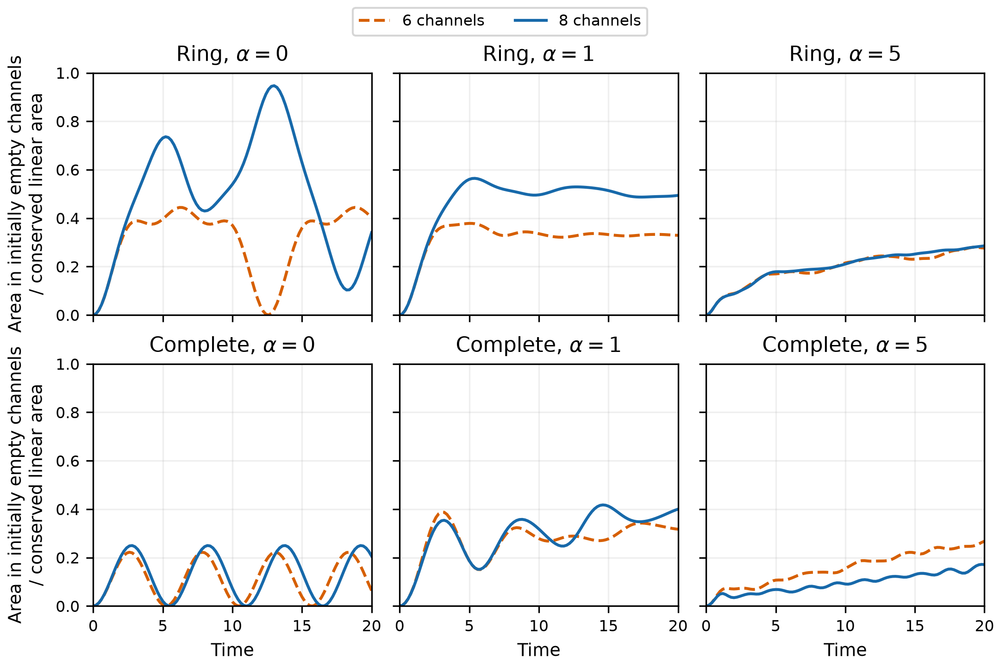
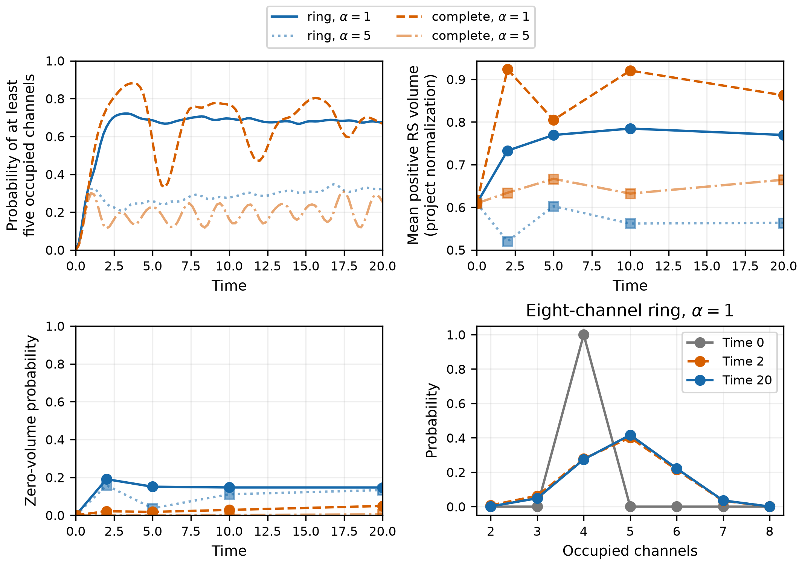

# Area spreading beyond an initially four-face quantum geometry

[Research map](quantum-geometry-research.md) · Related: [face activation connectivity](face-activation-connectivity.md), [hamiltonian studies](hamiltonian-studies.md).

*Exact closed-state dynamics, October 16, 2026.*

The connectivity calculation established that the Hamiltonian permits a closed
four-channel state to reach five or six occupied channels. We now ask whether
those channels actually acquire appreciable area during evolution, and what
happens to the state's quantum geometric observables as they do.

The initial regular tetrahedral preparation has exactly four occupied channels.
With eight available channels, the evolution develops substantial probability
for five or more occupied channels and puts a substantial fraction of linear
area into the four initially empty receivers. Closure remains exact, and the
sampled five-or-more-channel component has positive mean RS volume. The
next geometric question is whether these channels define distinct face
directions; we develop that question below.

## Preparing four occupied faces

We work at fixed linear area $K=4$, or eight Schwinger bosons. In the main
preparations the local occupations are

$$
(n_1,n_2,n_3,n_4,n_5,\ldots)=(2,2,2,2,0,\ldots).
$$

The first four channels each have $j_i=1$. We start from the fixed-area FL
intertwiner with four nonzero spinor labels and project onto this occupation
assignment. The projection is rotationally invariant, so the normalized
result is still an exact singlet. Unlike the unconditioned FL state, it has
exactly four occupied channels.

The labels use the closed equal-area family at $x=1/\sqrt3$. The regular
input has $\varphi=90^\circ$, and the deformed input has $\varphi=30^\circ$.
Their fixed-occupation projection probabilities are about 6.94% and 8.08%,
respectively. These probabilities describe preparation from the reference FL
states; the projected states themselves are normalized. Their angular
fluctuations will matter when we compare them with classical face normals.

A third preparation retains the unconditioned regular FL state as a separate
control. It has four nonzero input labels but fluctuating occupation, including
components with fewer than four active channels. Its free evolution has an
independent analytic solution through the spinor labels.

We compare four, six and eight available channels at the same total area.
The four-channel case can change shape and lose occupied channels, but cannot
activate a fifth. Six and eight channels provide two and four initially empty
receivers. Since eight bosons are available, all eight channels can in
principle be occupied.

## Dynamics and the meaning of local energy

With $\hbar=1$, the Hamiltonian is

$$
H=\alpha\sum_i\mathbf J_i^2
-\sum_{\langle ij\rangle}w_{ij}(E_{ij}+E_{ji}),\qquad
\mathbf J_i^2=\frac{n_i(n_i+2)}4.
$$

The ring uses $w=1/2$, and the complete graph uses $w=1/(L-1)$. Each
one-particle hopping row therefore has total weight one, giving a common
hopping scale across sizes. The graph specifies the allowed channel interactions. We use $\alpha=0,1,5$ and evolve
from time zero to 20 in inverse units of this hopping scale.

The Hamiltonian preserves total boson number and exact SU(2) closure.
Consequently $K=\sum_i j_i$ is conserved. The different area observable
$\sum_i\sqrt{j_i(j_i+1)}$ need not be conserved. No volume term is included
in the Hamiltonian.

For $\alpha>0$, the positive local energy term is $\alpha\mathbf J_i^2$.
Its sum can exchange energy with the hopping interaction, so it need not be
constant. We record both its redistribution and the full conserved energy.
For additional bookkeeping, each bond's hopping energy is divided equally
between its endpoints:

$$
H_i=\alpha\mathbf J_i^2
-\frac12\sum_{j:\langle ij\rangle}w_{ij}(E_{ij}+E_{ji}),
\qquad \sum_iH_i=H.
$$

This local interaction-energy assignment is a stated convention. At $\alpha=0$,
$\mathbf J_i^2$ remains a useful diagnostic but is not a term in the energy.

## Area reaches the initially empty channels

*Regular sharp-occupation preparation. The vertical axis is the linear area in
the initially empty channels divided by conserved $K$. Dashed orange curves
use six available channels; solid blue curves use eight. Ring and complete
graphs have the same hopping row-sum scale. The panels compare Casimir
couplings, not different total areas.*

| Graph | Casimir coupling $\alpha$ | Area in receivers | Probability of at least five occupied channels |
|---|---:|---:|---:|
| Ring | 0 | 53.0% | 56.8% |
| Ring | 1 | 50.6% | 68.1% |
| Ring | 5 | 25.3% | 30.9% |
| Complete | 0 | 12.4% | 42.0% |
| Complete | 1 | 34.6% | 67.6% |
| Complete | 5 | 12.7% | 20.6% |

The table reports equal-weight averages over saved times from 10 to 20.
Receiver area and occupied-channel probability are different measurements:
an activated channel may carry little area, and a state is generally a
superposition of occupation patterns.

The graph and coupling both matter. On the ring, stronger coupling reduces
transfer relative to the $\alpha=1$ case in this window. On the complete graph,
the free model transfers comparatively little from the sharp preparation;
adding the Casimir term can increase transfer before the stronger-coupling
case suppresses it again. The intermediate-coupling enhancement on the complete graph shows why a
single monotonic transfer-versus-coupling description would miss part of
the behavior.

There is a preparation-dependent selection rule in the symmetric complete graph.
For the regular sharp state, the probability of all eight channels being
occupied stays at numerical zero (below $2\times10^{-30}$ in this window),
even while five-, six- and seven-channel components develop. The deformed
sharp preparation has nonzero eight-channel probability under the same
Hamiltonian. A post-run permutation-symmetry check explains the distinction:
initially empty receivers are symmetric under their permutations; within the
all-eight singlet target, this requires a symmetric original-channel component,
which the regular sharp preparation lacks. The complete-graph Hamiltonian
preserves both group permutation symmetries. The ring lacks these full
permutation symmetries and gives nonzero eight-channel weight for the regular
preparation. This is why matrix connectivity must be followed by checks of
the particular initial state's symmetry.

## Geometry during redistribution

An exact singlet has $\langle\mathbf J_i\rangle=0$. It would therefore be
incorrect to reconstruct face normals by treating those vanishing means as
classical face vectors. We instead use flux correlations, their fluctuations,
and a positive volume operator.

For each pair, its angle operator is normalized separately in each local-spin
assignment,

$$
C_{ij}=\frac{\mathbf J_i\cdot\mathbf J_j}
{\sqrt{j_i(j_i+1)j_j(j_j+1)}}.
$$

We report its mean and standard deviation conditioned on both channels being
occupied, together with that conditioning probability. Missing-channel entries
are not interpreted as zero-angle measurements. The detailed pair data are
saved at times 0, 2, 5, 10 and 20.

The volume diagnostic is the single-vertex RS sum over all unordered triples,

$$
V_{\rm RS}=\gamma^{3/2}\sum_{i<j<k}\sqrt{|q_{ijk}|},\qquad
q_{ijk}=i[\mathbf J_i\cdot\mathbf J_j,\mathbf J_j\cdot\mathbf J_k].
$$

Here $\gamma=0.2375$ and the units are the repository's project normalization.
The triple sum is independent of the interaction graph. This differs from
the connected-induced-triple convention used for some earlier T11 graph
studies. We do not apply the four-valent tetrahedral volume-conversion factor
to higher-valence states.

*Eight-channel regular sharp preparation. Top left: probability of at least
five occupied channels. Top right: mean positive RS volume at five sampled
times. Bottom left: probability in the volume kernel. Bottom right: the
occupied-count distribution at three times for the ring with $\alpha=1$.
Lines between geometric samples are guides to the eye.*

The sampled component with five or more occupied channels has positive mean
RS volume whenever that component has appreciable weight. Activation is thus
not restricted to zero-volume states. The saved pair-angle distributions provide the next part of the geometric
analysis: deciding how many different directions are resolved by these
occupied channels.

## Entanglement between channels

The global state stays pure and closed. For one channel, fixed total boson
number forbids coherence between different local occupation sectors, and
SU(2) invariance makes the reduced state proportional to the identity within
each spin sector. If $p_i(n)$ is its occupation distribution,

$$
S_i=-\sum_n p_i(n)\log\frac{p_i(n)}{n+1}.
$$

The initially occupied spin-one channels already have entropy $\log3$,
reflecting entanglement required by singlet closure. Initially empty channels
have zero entropy. The evolved entropies are saved without constructing large
density matrices. They quantify single-channel entanglement with the remaining system.

## Recovering face directions

There are two separate geometric questions: how many different directions the
occupied channels resolve, and how narrowly the state is concentrated around
a classical shape. Neither requires individual mean fluxes to be nonzero.
The relative directions are encoded in the correlations of a rotationally
invariant state.

The natural first control is the free evolution of the unconditioned FL state.
Its labels evolve exactly by the one-particle hopping matrix, so their normals
can be read off directly:

$$
\mathbf n_i(t)=\frac{z_i(t)^\dagger\boldsymbol\sigma z_i(t)}
{z_i(t)^\dagger z_i(t)},\qquad
z_i(t)^\dagger z_i(t)>0.
$$

For equal complete-graph hopping, an initially empty row evolves to a common
coefficient multiplying the sum of the occupied input rows. Thus all initially
empty channels have proportional spinors whenever they activate, and their
normal directions coincide. Several nonzero channel areas can therefore
contribute to the same classical face. This can happen within the FL family
itself; departure from coherence is not the reason for distinguishing channel
count from geometric face count. The earlier [face-activation note](face-energy-equipartition.md)
discusses the same mechanism.

Our sharp preparations also have a coherent geometric origin. Conditioning a
fixed-area FL state on individual spins gives a coherent intertwiner with
those spins. It retains the input shape labels, together with finite-spin
angular fluctuations. The Casimir interaction then generally moves the state
outside the coherent family.

For the interacting runs, we would begin with the saved pair-angle means,
widths and pair-presence probabilities at selected times. They should be
compared with coherent reference states at the same local spins. A quantum
angle mean need not equal the cosine of the input classical angle at small
spin; the reference calculation supplies the appropriate finite-spin comparison.
Simply fitting a three-dimensional Gram matrix to the means would omit this
information.

The next proposed calculation is a coherent-state comparison within the
occupation sectors carrying most of the probability. Candidate input normals
must obey

$$
\sum_i j_i\mathbf n_i=0.
$$

Their coherent intertwiners can be compared with the sector state using
overlaps and angular fluctuations. A concentrated distribution of good
matches supports a recognizable shape; broad or competing matches describe
a spread of geometries. Coincident normal directions should be combined
when counting classical facets. Overall rotation changes no relational
geometry.

Only a few selected wavefunctions need to be regenerated for this comparison;
the observable histories are already saved, and regenerated vectors can be
discarded after measurement. The controls should then be repeated at larger
area, first with four and five channels. In the present $K=4$ all-eight sector,
every face has $j=1/2$. Increasing area permits angular distributions to narrow
while keeping several faces occupied.

This face-direction analysis is the next proposed study. The completed
calculation establishes actual area redistribution with closure and
positive-volume components. Its 54 trajectories compare channel count,
preparation and coupling; a subsequent equilibrium study would ask how long
the evolving observables remain near an appropriate reference ensemble.

## Numerical checks and retained data

The main eight-channel singlet basis has 13,860 states, embedded sparsely in
108,900 magnetic $M=0$ occupation states. We do not construct the much larger
full Fock space. Hamiltonians, embeddings, hopping and global geometry operators
are sparse. Dense roots are taken only in small fixed-local-spin blocks; no
dense global propagator or density matrix is formed.

All 73 regression tests pass. Production operator and trajectory checks have maximum residual 6.43e-12. An independent saved-observable audit checks 91,476 quantities, including all 606 free-FL frames against analytic spinor evolution; its maximum residual is 6.43e-12. Selected interacting states also agree with magnetic-space propagation. Small-system tests independently check the full-space Hamiltonian projection, a known four-spin-half RS volume, local energy partition, and single-channel entropy by an explicit partial trace.

The [result report](../results/t11-geometric-redistribution/README.md) records
parameters, checks, performance and reproduction commands. Only compact
observable histories, geometric samples, initial coefficients, provenance and
figures are retained. State-vector histories and intermediate operators are
released after use; no large permanent data archive is produced.
