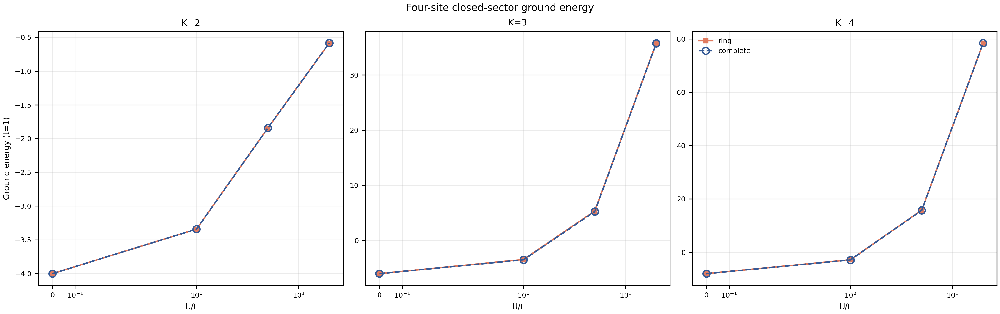
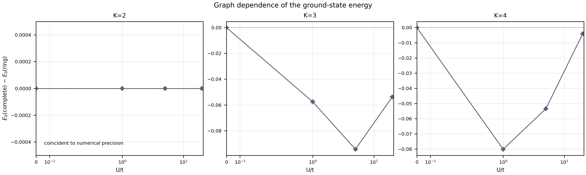

# Four-site Hamiltonian spectra and positive-RS volume observables

[Research map](quantum-geometry-research.md) · Related: [volume studies](volume-studies.md), [geometric area redistribution](geometric-area-redistribution.md).

*Created: 2026-10-09 11:35:15 IST*
*Last Updated: 2026-10-11 11:51:12 IST*

This note records the first numerical milestone of the proposed lattice-Hamiltonian program. It covers four available sites, fixed $K=2,3,4$, total SU(2) spin zero, and the optional spin-exchange setting $g=0$. No geometric volume coupling is included. This is a finite-sector study, not a thermodynamic-limit or phase-transition result.

## Hamiltonian and separate volume observable

The calculation has four sites, fixed total boson number $N_b=2K$, and total SU(2) spin zero; empty sites are allowed. The exact singlet dimensions are 20, 50, and 105 for $K=2,3,4$. The driver compares:

- the complete graph on four sites, with six allowed hopping bonds;
- the periodic four-site ring, with four allowed hopping bonds.

Every allowed bond has the same hopping strength $t$. With $E_G$ denoting the edge set of the chosen graph, the operator whose spectrum and Gibbs states were calculated is

$$
H_G=-t\sum_{(i,j)\in E_G}(E_{ij}+E_{ji})
+\frac U2\sum_i n_i(n_i-1),
\qquad E_{ij}=a_i^\dagger a_j+b_i^\dagger b_j,
\qquad n_i=a_i^\dagger a_i+b_i^\dagger b_i.
$$

The interaction is on-site repulsion. The controls are no hopping $(t,U)=(0,1)$ and $t=1$ with $U/t=0,1,5,20$. The evaluated matrix contains only the hopping and on-site terms displayed above. In particular, **no volume-dependent term is included in $H_G$**.

The volume is a distinct positive Rovelli–Smolin (RS) operator, evaluated on Hamiltonian eigenstates and Gibbs states as an observable:

$$
V=(\gamma\hbar)^{3/2}\sum_{\tau\in\mathcal T_G}\sqrt{|q_\tau|},
\qquad q_{ijk}=i[\mathbf J_i\cdot\mathbf J_j,\mathbf J_j\cdot\mathbf J_k],
$$

using $\gamma=0.2375$ and $\hbar=1$. A triple is included when its induced three-site subgraph is connected; mutual adjacency is not required. Both four-site graphs select the same four triples, so they use the same $V$ operator. The graph comparison therefore changes the hopping term in $H_G$, not the volume observable. This is not a calculation with a geometric interaction such as $g_VV$; physical volume calibration also remains open.

The singlet basis couples $((j_0,j_1)k,(j_2,j_3)k)$ to total spin zero, with Condon–Shortley phases. The magnetic $M=0$ occupation basis is used to project the spin-independent hopping terms into the exact singlet space. Volume terms are built in each local-spin block from their positive spectral roots.

The raw plot shows the ground energies $E_0$ of $H_G$ against $U/t$ for $t=1$, separately for $K=2,3,4$. The complete and ring curves coincide for $K=2$ and remain close, though not identical, for $K=3,4$.



*Ground energies of the hopping-plus-repulsion Hamiltonian $H_G$; the plotted cases are $U/t=0,1,5,20$. The separate no-hopping control $(t,U)=(0,1)$ is not on these curves.*

The difference plot resolves the graph effect: $E_0(\mathrm{complete})-E_0(\mathrm{ring})$ is zero to numerical precision for $K=2$ at all plotted $U/t$ values, while for $K=3$ it is $-0.05754,-0.09437,-0.05379$ at $U/t=1,5,20$; for $K=4$ it is $-0.08014,-0.05347,-0.00408$.



*The difference plot is derived from the same $E_0(H_G)$ values shown above.*

## Calculated outputs

For each $K$, graph, and control, the driver records the full energy spectrum, ground energy and gap, ground-subspace volume moments, volume-zero probability, active-site count, pairwise occupation and spin correlations, and the site-0 reduced-state entropy and purity in the zero-temperature Gibbs state. It also forms the fixed-$K$ Gibbs state for $\beta=0,0.1,0.25,0.5,1,2,4,8,16$ and the zero-temperature limit. Thermal outputs include energy, entropy, heat capacity, volume moments, volume-measurement probabilities, and $P(N)$ with conditional volume at each active-site count. The reported site entropy is for the equal mixture of degenerate ground states where applicable; it is not reported as an entanglement measure.

| $K$ | Singlet dimension | No-hop ground energy | Free-hopping ground energy | $U/t=20$ complete / ring ground energy |
|---:|---:|---:|---:|---:|
| 2 | 20 | 0 | -4 | -0.585732 / -0.585732 |
| 3 | 50 | 2 | -6 | 35.740181 / 35.793968 |
| 4 | 105 | 4 | -8 | 78.474435 / 78.478518 |

In the no-hopping control, the two graph spectra agree and the ground space has all four sites occupied. In the free control, the lowest energy is $-2K$ on both graphs, although their gaps and volume distributions differ. At $U/t=20$, the $K=4$ complete-graph ground state has a small gap of about $0.00923$ and mean volume about $0.03349$; the ring gives about $0.35987$ and $0.28317$. These are observations in a 105-dimensional sector, not evidence for a phase transition.

At $\beta=0$, the mean volume matches the saved four-face equal-weight RS baseline: $0.030465319024$, $0.093434906442$, and $0.175563653024$ for $K=2,3,4$. The volume-outcome and active-site probabilities each normalize to one within floating-point error.

The infinite-temperature active-site distribution also matches the exact kinematic count

$$
P_\infty(N\mid K,L)=\frac{\binom{L}{N}D_K(N)}{d_L(K)}.
$$

Here $D_K(N)$ counts closed singlets with all $N$ labelled active sites carrying positive spin, and $d_L(K)$ counts the complete closed space with $L$ available sites, including empty ones.

For $L=4$, the probabilities at $N=2,3,4$ are $(0.30,0.60,0.10)$ for $K=2$, $(0.12,0.56,0.32)$ for $K=3$, and $(0.057143,0.457143,0.485714)$ for $K=4$. The $N=1$ probability is zero in all three sectors.

The pair correlations also satisfy the singlet closure identity $\langle\mathbf J_i^2\rangle+\sum_{j\ne i}\langle\mathbf J_i\cdot\mathbf J_j\rangle=0$ to a maximum residual of $8.9\times10^{-16}$ across the saved ground-state mixtures.

## Follow-up: the $K=4$ thermal volume crossover

The initial $U/t=5$ figure ended at $\beta/t=16$ and omitted the zero-temperature limit. The follow-up samples $K=4$ at $\beta=0$, 601 logarithmically spaced values from $10^{-3}$ to $10^3$, and $\beta\to\infty$. It covers no hopping and all four $t=1$ interaction controls, and records $\langle V\rangle$, $P(V=0)$, mean active-site count, energy, and the energy–volume covariance. A second table groups degenerate energy eigenspaces and records their mean volume and zero-volume probability.

The nonmonotonic response is not exclusive to hopping: the no-hopping control also rises from the infinite-temperature mean $0.175564$ to a maximum near $0.446392$ at $\beta/t\approx1.78$, then approaches its ground-state mean $0.406204$. With hopping, the maximum shifts to lower $\beta$ as $U/t$ grows. For $U/t=5$, it is about $0.4419$ near $\beta/t=0.4$ for both graphs; the zero-temperature means are $0.184330$ (complete graph) and $0.336318$ (ring). For $U/t=20$, the maximum is about $0.4461$ near $\beta/t=0.089$; the zero-temperature means are $0.033487$ and $0.283172$, respectively.

The energy-resolved data identify a low-temperature crossover rather than a monotone approach to the ground state. At $U/t=5$, the complete graph has a first excited doublet only $0.124901$ above its ground state, with mean volume $0.559168$, compared with ground-state mean $0.184330$. The ring's first excited level is $0.666929$ above its ground state and has mean volume $0.561417$. At $U/t=20$, the complete graph's first excited doublet lies just $0.0092257$ above a ground state with mean volume $0.033487$; the doublet mean is $0.601103$. Its zero-volume probability rises to $0.931544$ in the ground state. The corresponding ring gap is $0.359870$, with ground-state mean volume $0.283172$ and zero-volume probability $0.521863$. The small complete-graph gap explains why the finite-$\beta$ curve is still well above its ground-state limit at $\beta/t=16$.

This temperature dependence follows the exact finite-system identity

$$
\frac{d\langle V\rangle_\beta}{d\beta}
=-\operatorname{Cov}_\beta(E,V_{nn}),
\qquad V_{nn}=\langle n|V|n\rangle,
$$

so the curve rises or falls as the Gibbs weights shift among energy eigenspaces with different volume expectations. The low-lying groups in these cases remain concentrated near four active sites, so the ground-state drop is not explained by a transition to a mostly empty-site sector. These are finite four-site crossovers, not phase-transition evidence.

## Hamiltonian–volume commutator

The projected onsite term commutes with each volume term to a maximum residual of $2.3\times10^{-16}$, consistent with $[n_i,q_{jkl}]=0$. The numerical decomposition of $[H,V]$ into triple terms and edge–triple terms has maximum residuals $3.6\times10^{-15}$ and $7.2\times10^{-15}$.

For $t=1$, the Frobenius norms of $[H,V]$ are independent of $U$, as expected because $[H_U,V]=0$:

| $K$ | Complete graph | Four-site ring |
|---:|---:|---:|
| 2 | 2.110699 | 1.723379 |
| 3 | 6.031197 | 4.924452 |
| 4 | 13.015778 | 10.627338 |

Within these closed four-site sectors, the four positive triple-root matrices agree to at most $8.4\times10^{-17}$. Their commutators therefore add without a reduction in Frobenius norm; this is specific to this four-valent singlet support and does not establish a cancellation rule for larger graphs.

## Reproduction and files

Run from the repository root:

```bash
conda run -n qc-diff python code/python/hamiltonian_studies.py
```

The saved run used the `qc-diff` Conda environment (Python 3.10.19, NumPy 1.24.3, SciPy 1.15.3, SymPy 1.14.0, and Matplotlib 3.10.8). The driver writes five figures in both PDF and PNG formats: ground energy versus repulsion, graph energy differences, the $U/t=5$ thermal-volume curve, a dense $K=4$ thermal scan, and the low-energy volume spectrum.

- [Driver](../code/python/hamiltonian_studies.py)
- [JSON summary](../results/hamiltonian-studies/summary.json)
- [Energy levels and controls](../results/hamiltonian-studies/energy_levels.csv)
- [Ground-state summary](../results/hamiltonian-studies/spectra.csv)
- [Thermodynamics](../results/hamiltonian-studies/thermodynamics.csv)
- [Active-site probabilities](../results/hamiltonian-studies/active_site_probabilities.csv)
- [Infinite-temperature active-site counts](../results/hamiltonian-studies/kinematic_active_site_counts.csv)
- [Ground-state correlations](../results/hamiltonian-studies/ground_state_correlations.csv)
- [Ground-state one-site reduced state](../results/hamiltonian-studies/ground_state_reduced_state.csv)
- [Volume distributions](../results/hamiltonian-studies/volume_distributions.csv)
- [Edge–triple commutator terms](../results/hamiltonian-studies/commutator_edge_triple_terms.csv)
- [Dense $K=4$ thermal scan](../results/hamiltonian-studies/k4_thermal_volume_scan.csv)
- [Energy-resolved $K=4$ volume](../results/hamiltonian-studies/k4_energy_resolved_volume.csv)
- Operator and basis archives: `results/hamiltonian-studies/operators_k{2,3,4}_{complete,ring}.npz`.
- Figures: `results/hamiltonian-studies/ground_energy_vs_repulsion.{pdf,png}`, `ground_energy_graph_difference.{pdf,png}`, and `thermal_volume_u5.{pdf,png}`.
- Detailed figures: `results/hamiltonian-studies/k4_thermal_volume_scan.{pdf,png}` and `results/hamiltonian-studies/k4_low_energy_volume_spectrum.{pdf,png}`.

The broader program remains open: larger site counts and areas, optional spin exchange, quenches and entanglement, fluctuating-area ensembles, and the energy-basis TFD comparison have not been implemented. Strict one-boson-per-site dynamics also require a spin Hamiltonian or a derived effective interaction because ordinary hopping leaves that subspace.


## T11 continuation: larger-system and tetrahedral-state results

*Recorded: 2026-10-11 10:27:17 IST*

The previous session completed two studies at the existing $g=0$ Hamiltonian:

- [Four/five-site persistence report](../results/t11-size-comparison/README.md): $(L,K)=(4,4)$ versus $(5,5)$ at $2K/L=2$, complete and ring graphs, $t=1,U=20$, free and no-hop controls. Nonmonotonicity persists, but the pronounced complete-graph low-temperature collapse does not. The complete gap changes from $0.0092257t$ to $12.643382t$; five-site ground degeneracy is six. Coordination and ring parity change, so this is not clean finite-size scaling. Both total volume and volume per selected triple are saved.
- [Prepared FL diagnostics report](../results/t11-geometric-interpretation/README.md): five $K=4$ references with $\varphi=90,60,30,10,0$ degrees, equal input face areas and closure. Spin means/covariances, assignment probabilities, pair dots, assignment-normalized angles and symmetrized covariances, volume/signed-grasp distributions and overlaps were calculated, then compared with low-energy groups and the full Gibbs spectrum.

The regular FL reference has $\langle j_i\rangle=1$, spin standard deviation $0.5$, four-face weight $0.754630$, all pair-dot means $-0.75$, conditioned angular means $-0.286237$ and standard deviations $0.557147$. Its converted volume is $0.037587$ versus input classical volume $0.047872$, using the existing four-valent factor $\sqrt2/12$.

Complete-graph ground and first excited four-face weights are $0.999934$ and $0.999878$; equal-spin assignment weights are $0.931429$ and $0.932435$. In that assignment, ground/excited positive volumes are $0$/$0.609306$, angular means both $-1/3$, and angular standard deviations $0.745356$/$0.552771$. Ground overlap with the regular reference is zero; the flat-reference overlap is $0.444444$ and regular-reference overlap with the excited mixture is $0.5$, all within the common assignment. Thermal suppression is explained by transfer of weight to a kernel-dominated ground state, rather than disappearing faces.

The $105$-dimensional singlet space contains $38$ positive-volume and $67$ zero-volume eigenstates. Four-active-face support has $51$ dimensions: $38$ positive and $13$ zero. The coupled singlet basis, volume eigenbasis, energy eigenbasis and prepared FL states are distinct objects in this space. The detailed enumeration is preserved in the [2026-10-11 physics transcript](../memory-bank/sessions/2026-10-11-t11-hamiltonian-transcript.md).

Previous-session verification: 38 tests passed for the size comparison, then 42 with the new diagnostics. Independent checks include magnetic counts, closure, hopping leakage, epsilon-contracted triples, analytic free/no-hop limits, conditioning, overlaps, degeneracy and matrix-exponential Gibbs controls. Largest geometric residual was $5.14\times10^{-12}$, below $2\times10^{-10}$. No new Rust calculation. These are previous-session results; this documentation update does not rerun the physics.

### Current modelling discussion and completed calculations

The hopping graph specifies interactions. Complete four-site connectivity also matches tetrahedral face adjacency; the ring is a sparse-interaction control. No particular five-faced polyhedron was constructed in the persistence test. The second term is **on-site repulsion**: $H_U=U\sum_i\binom{n_i}{2}$. Equal occupation at fixed total number is a consequence, not its defining interpretation.

The discussion introduced the positive-volume candidate $H_V=H_0+g_VV_{\mathrm{RS}}$ and the signed candidate $H_\chi=H_0+\lambda_\chi Q_\chi$. Here $g_V$ distinguishes the volume coupling from the earlier optional spin-exchange coefficient $g$. Both candidates are now tested across the parameter ranges recorded below; the signed term uses a fixed, closure-consistent orientation. Nonzero volume was already possible under $H_0$ without either addition.

The prepared $K=4$ FL references have now been evolved under the complete-graph $H_0$, $H_V$ and $H_\chi$ models for $U/t=5,20$. All five input angles ($90^\circ,60^\circ,30^\circ,10^\circ,0^\circ$) are included. The exact energy-basis trajectories record geometric readouts, return probability, and norm, energy, total-area and closure checks. The earlier $K=2,U=5$ probe remains a separate calculation.

## Physics transcripts

The full physics dialogues are kept in separate session records, rather than duplicated in this research note:

- [2026-10-10: T11 geometry and singlet enumeration](../memory-bank/sessions/2026-10-10-t11-geometry-transcript.md)
- [2026-10-11: T11 Hamiltonian and volume discussion](../memory-bank/sessions/2026-10-11-t11-hamiltonian-transcript.md)

## T11 follow-up: explicit positive-volume coupling

*Recorded: 2026-10-11 12:13 IST*

The first proposed geometry-dependent Hamiltonian has now been tested:

$$
H=H_0+g_VV_{\mathrm{RS}},\qquad
H_0=-t\sum_{i<j}(E_{ij}+E_{ji})+
\frac{U}{2}\sum_i n_i(n_i-1).
$$

This is the four-site complete graph, interpreted as tetrahedral face adjacency, in the full $K=4$, total-spin-zero space (105 states), with $t=1$, $U/t=20$, and historical spin exchange set to zero. Couplings use $\alpha_V=g_V\Delta V/t$, where the volume-operator spectral range is $\Delta V=0.609306380473$ project units; the scan is $\alpha_V=-1,0,+1$. The zero-coupling result reproduces the earlier pilot.

At zero temperature, the ground-space mean volumes for negative, zero and positive coupling are $0.601241$, $0.033487$ and $0.031332$ project units. The negative-coupling ground space is twofold degenerate and has $P(V=0)=0.000193$; the baseline and positive-coupling ground spaces have zero-volume probabilities $0.931544$ and $0.935951$. The first gap grows from $0.009226t$ at zero coupling to $0.920552t$ and $0.942482t$ for negative and positive coupling, respectively.

At $\beta t=10$, the mean volumes are $0.601213$, $0.400087$ and $0.031424$ for $\alpha_V=-1,0,+1$. Thus negative coupling selects high-volume ground states, while positive coupling makes the low-temperature volume collapse occur much earlier than in the baseline. However, the regular FL reference has only $0.112216$ probability in the negative-coupling ground eigenspace; high volume alone does not select that prepared reference.

The complete thermal scan, ground and FL-reference readouts, volume distributions, protocol, provenance, and independent verification are in the [positive-volume-coupling report](../results/t11-volume-coupling/README.md). The [figure](../results/t11-volume-coupling/volume_coupling_response.png) compares the thermal response, ground-space volume and kernel weight, and FL overlaps. The independent NumPy-spectrum and SciPy matrix-exponential checks passed (78 checks; maximum residual $7.44\times10^{-13}$ below $2\times10^{-10}$). The oriented signed-grasp candidate and prepared FL-state dynamics are completed in the follow-up below.

## T11 follow-up: complete candidate-Hamiltonian comparison

*Recorded: 2026-10-11 13:15 IST*

The full four-site candidate study compares

$$
H_V=H_0+g_VV_{\mathrm{RS}},
\qquad
H_\chi=H_0+\lambda_\chi Q_\chi,
$$

in the $K=4$, total-spin-zero singlet space. The baseline interaction is on-site repulsion, $U\sum_i\binom{n_i}{2}$. The complete graph represents tetrahedral face adjacency; the ring is retained only as a sparse-hopping control. The complete-graph scans use $U/t=0,1,5,20$ and $\alpha=-2,-1,-0.5,0,0.5,1,2$ for each candidate. The ring control uses $U/t=5,20$ and $\alpha_V=-1,0,1$. All five prepared FL references are included in the static state comparisons.

For the orientation $(+,-,+,-)$ on $(012,013,023,123)$,

$$
Q_\chi=q_{012}-q_{013}+q_{023}-q_{123}=4q_{012},
\qquad
V_{\mathrm{RS}}=2\gamma^{3/2}\sqrt{|Q_\chi|},
$$

within the existing positive-root cutoff. This is an exact relation in this closed four-face space, so the positive-volume and signed-grasp terms are related tests rather than independent volume observables. $H_\chi$ adds a chirality bias: at $U/t=20$, either sign of $\alpha_\chi$ selects a high-volume ground state, while the sign of $\langle Q_\chi\rangle$ reverses. The spectra at opposite coupling signs agree under complex conjugation. In contrast, $H_V$ with $\alpha_V=-1$ selects high volume and $\alpha_V=+1$ suppresses it.

At $\beta t=10$ and $U/t=20$, the complete-graph mean volume is $0.400087$ for $H_0$, $0.601213$ for $H_V$ with $\alpha_V=-1$, $0.031424$ for $H_V$ with $\alpha_V=+1$, and $0.596491$ for either sign of $H_\chi$. For the ring volume-coupling control, the corresponding means are $0.539372$, $0.291685$, and $0.110923$. All values are project RS units.

All five prepared FL references ($\varphi=90^\circ,60^\circ,30^\circ,10^\circ,0^\circ$) were propagated under $H_0$, $H_V$ at $\alpha_V=\pm1$, and $H_\chi$ at $\alpha_\chi=\pm1$, for $U/t=5,20$. These 50 exact energy-basis trajectories track return probability and the same volume, face-area, active-face, angular and signed-grasp readouts. A uniformly resolved time grid would require $4.4$ million to $2.01$ billion points per trajectory. The saved data therefore use dense samples over ten fastest-beat periods and 900 logarithmic-time samples through ten slowest-beat periods, with the uniform-grid counts recorded separately.

Full parameters, results, plots, and limitations are in the [candidate-Hamiltonian report](../results/t11-candidate-hamiltonians/README.md). The result directory contains all static spectra, full Gibbs scans, prepared-state readouts, all five-seed FL evolution samples, schedules, validation, independent verification, provenance, and five figures. The new ground-energy plot shows the Hamiltonian ground-energy shift $(E_0(\alpha)-E_0(0))/t$ for each candidate term and $U/t$; it is distinct from the volume-response plots. The independent verifier passed 1,510 checks with maximum residual $1.07\times10^{-12}$, below $2\times10^{-10}$. This closes the agreed candidate comparison on the current $K=4$ sector; physical volume calibration and larger-area tests remain open.
