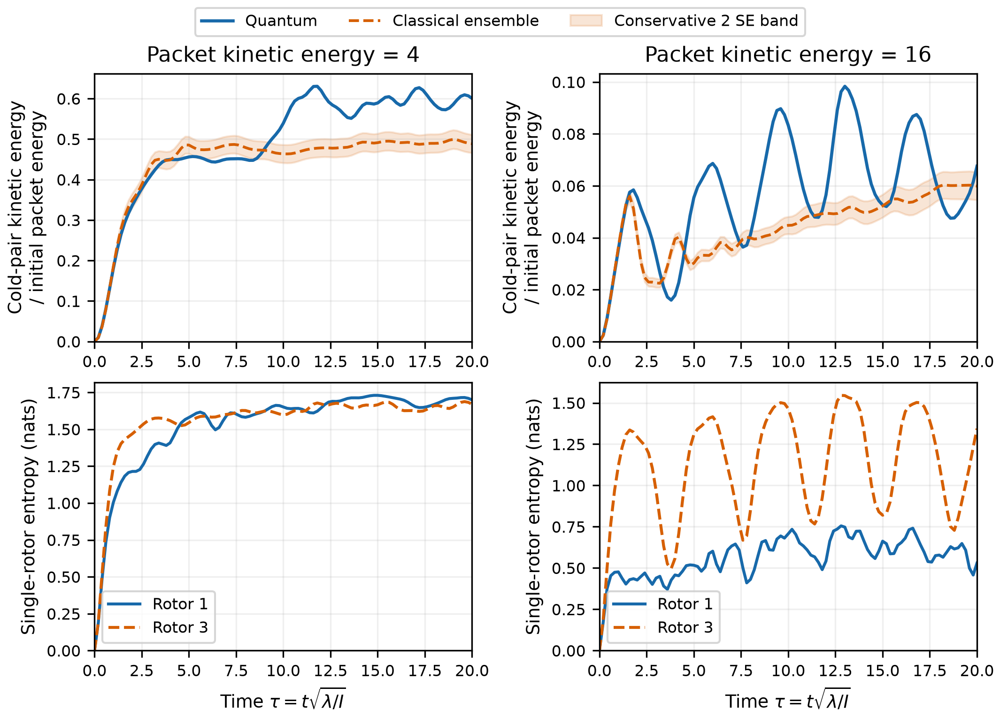

# Energy transfer between four quantum planar rotors

[Research map](quantum-geometry-research.md) · Related: [classical rotor equilibration](classical-rotor-equilibration.md), [face activation connectivity](face-activation-connectivity.md).

*First zero-total-angular-momentum quantum benchmark, October 16, 2026.*

Can two initially energetic rotors give kinetic energy to initially resting
neighbors while the total angular momentum remains exactly zero? Two identical
rotors cannot answer this question: if their momenta sum to zero, their kinetic
energies are equal at every instant. Four rotors give us an energetic pair and
a separate receiving pair. We connect them in a ring, with bonds 12, 23, 34,
and 41.

The present calculation quantizes planar mechanical rotors. It follows the
[classical energy-transfer studies](classical-rotor-equilibration.md), with a
sharp momentum preparation and uniformly distributed angles. The connection
to closed face states is developed in [Hamiltonian connectivity](face-activation-connectivity.md)
and [geometric redistribution](geometric-area-redistribution.md).

## Why four rotors

For two equal-inertia rotors at zero total angular momentum,

$$
p_2=-p_1,\qquad T_2=T_1.
$$

The quantum zero-total-momentum sector consists of $|m,-m\rangle$ components,
with equal local kinetic energies in every component. The analogous
three-dimensional singlet requires $j_1=j_2$. Such a pair can exchange kinetic
energy with the interaction, but cannot provide a hot pair and a separate
cold receiver.

Three rotors are enough in principle. There is a special classical triangle
preparation in which all initial angles agree and the momenta are $+p,-p,0$.
The moving angles remain $a(t)$ and $-a(t)$, so the torque on the third rotor
is $\lambda[\sin a+\sin(-a)]=0$. It remains stationary. This is the
[symmetric classical control](few-rotor-energy-transfer.md), rather than a
restriction on generic three-rotor transfer. In a quantum state, zero mean
momentum alone would not imply zero mean kinetic energy, since the latter
depends on the squared momentum.

Four rotors give a clean preparation: two initially energetic rotors and two
initially cold receivers, with exact zero total momentum throughout. The
planar model isolates this redistribution mechanism before imposing the
three-component closure condition of the geometric states.

## Preparing an energetic pair without net angular momentum

A planar rotor has angle $\theta_i$ and integer momentum label $m_i$, with
$p_i=\hbar m_i$. We use

$$
H=\sum_{i=1}^4\frac{p_i^2}{2I}
+\lambda\sum_{\langle ij\rangle}[1-\cos(\theta_i-\theta_j)].
$$

The interaction depends only on differences of angles, so it preserves the
sum of the momenta. We work entirely in the sector $\sum_i m_i=0$ and start
from

$$
|\psi(0)\rangle=|m,-m,0,0\rangle.
$$

Rotors 1 and 2 initially have equal kinetic energies and opposite momenta.
Rotors 3 and 4 have exactly zero kinetic energy. This is a product state,
with no initial entanglement.

A sharp momentum does not specify a definite orientation. In angle space,

$$
\psi(\theta_1,\theta_2,\theta_3,\theta_4)
=\frac{1}{(2\pi)^2}\exp[im(\theta_1-\theta_2)].
$$

Its squared modulus is uniform over all four angles. The initial mean
potential energy is therefore $4\lambda$. The initial total energy is not
sharp. A matched classical ensemble uses independent uniform angles and the
same exact momenta $(\hbar m,-\hbar m,0,0)$ in every realization. This is a
comparison with a distribution of classical preparations, not a single
aligned classical trajectory.

## How the interaction moves kinetic energy

For each bond,

$$
-\lambda\cos(\theta_i-\theta_j)
=-\frac{\lambda}{2}\left[e^{i\theta_i}e^{-i\theta_j}
+e^{-i\theta_i}e^{i\theta_j}\right].
$$

Each term adds one unit of momentum to one rotor and removes one from its
neighbor. The total stays zero, while the individual squared momenta can
change. A receiving rotor can have zero mean signed momentum and still gain
kinetic energy: equal weights at $+\hbar$ and $-\hbar$ cancel in the mean
momentum, but add in its square.

We measure the receiving-pair kinetic energy through

$$
f_{\rm cold}(\tau)=\frac{\langle T_3+T_4\rangle_\tau}{T_{\rm packet}(0)}.
$$

This is a kinetic-energy ratio, not a fraction of total conserved energy.
Interaction energy can also become kinetic energy, so there is no general
requirement that this ratio remain below one.

## Quantum and classical evolution

We set $I=\lambda=\hbar=1$, so $\epsilon=\hbar/\sqrt{I\lambda}=1$ and
$\tau=t\sqrt{\lambda/I}=t$. The initial values $m=2,4$ give packet kinetic
energies 4 and 16. Both runs extend to $\tau=20$. This is a finite quantum
comparison at one value of $\epsilon$, not a semiclassical-limit study.

*Top: kinetic energy acquired by the initially resting pair, divided by the
initial packet kinetic energy. The dashed curves average 2,048 classical
preparations; shading is a conservative two-standard-error band at each
sampled time. Bottom: the quantum entanglement entropy of an initially
energetic rotor and an initially cold rotor. Entropies use natural logarithms.*

| Initial packet energy | Quantum mean cold-pair ratio | Classical mean cold-pair ratio |
|---:|---:|---:|
| 4 | 59.20% | 48.52% |
| 16 | 6.71% | 5.32% |

These are equal-weight means over the saved times $10\leq\tau\leq20$, including both endpoints.

The lower packet energy produces substantially more transfer over this
window. Both quantum runs entangle individual rotors with the rest of the
ring. In a fixed-total-momentum state, a single rotor's reduced density matrix
is diagonal in momentum: different local momenta require different total
momenta in the remaining three rotors. Its entropy can therefore be computed
from its momentum probabilities. Since the whole state remains pure, this
is an entanglement entropy, not a thermodynamic entropy assigned to a bath.

The finite-time contrast is clear: the lower-energy packet redistributes
much more strongly in this observation window. The next rotor comparison
would vary $\epsilon$ with matched orientation and momentum distributions,
including packets localized in relative angles. The
[closed geometric study](geometric-area-redistribution.md) takes a different
next step: replacing mechanical rotors with face channels while retaining
exact closure.

## Numerical checks and reproducibility

The calculation retains $|m_i|\leq c$ and $\sum_i m_i=0$. The interaction is
projected at the cutoff without wrapping momenta. Successive cutoffs are
compared for every saved local kinetic mean, entropy and return probability;
cutoff boundary populations and conservation residuals are recorded as well.
The classical trajectories use identical angle samples for step refinement.

The [pre-run protocol](../results/t11-quantum-planar-rotors/protocol.md),
[results report](../results/t11-quantum-planar-rotors/README.md), and
[machine-readable summary](../results/t11-quantum-planar-rotors/summary.json)
record the parameters and validation. Independent checks compare interaction
matrix elements against Fourier quadrature, sparse evolution against dense
matrix exponentiation, entropy against an explicit partial trace, and
classical motion against an independent adaptive ODE solution. The exact
zero-momentum two-rotor restriction and the symmetric classical triangle are
also checked.
