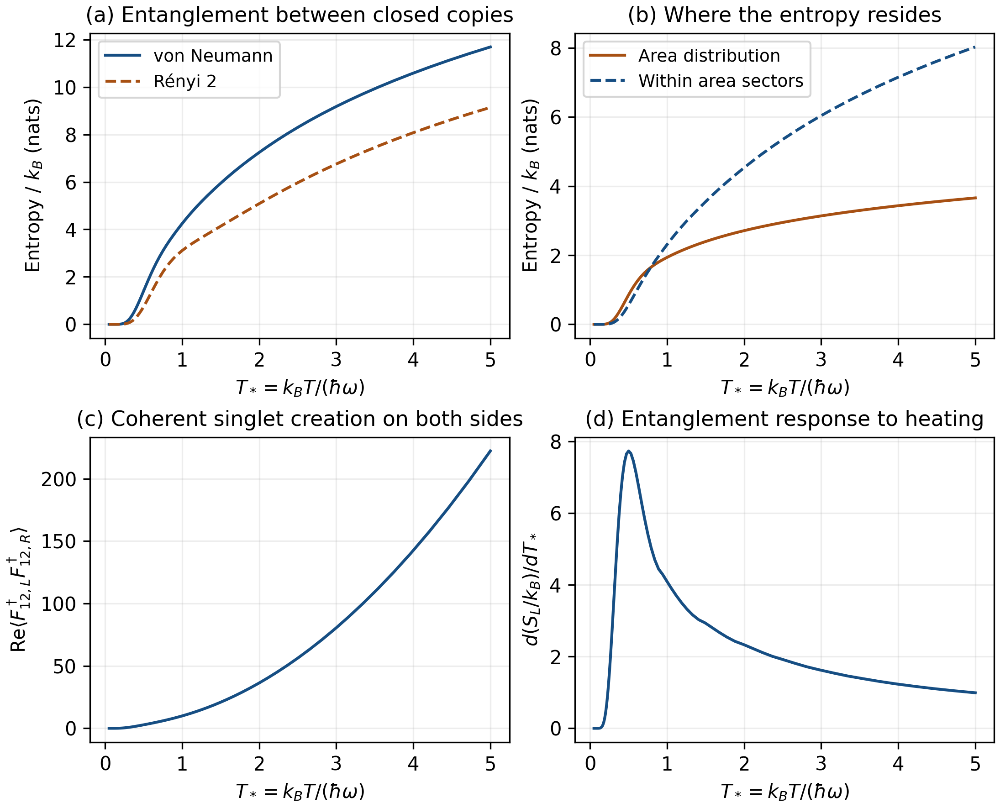
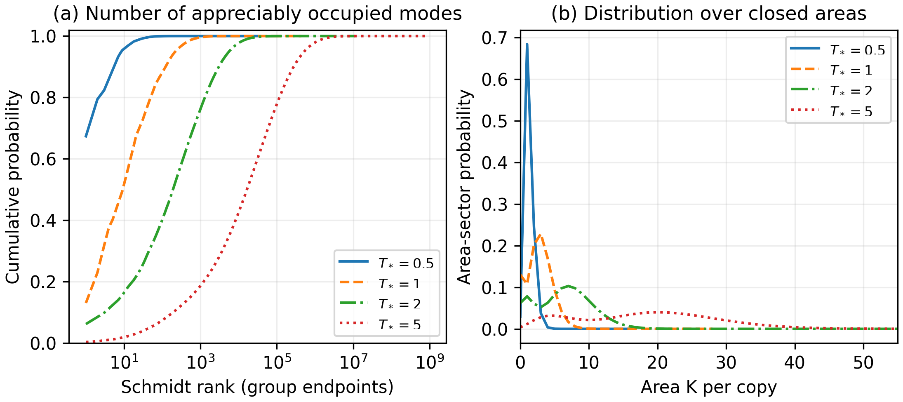

# Entanglement of two closed quantum polyhedra

[Research map](quantum-geometry-research.md) · Related: [thermal area sectors](thermal-area-sectors.md), [thermal geometry and singlet exchange](thermal-geometry-and-singlet-exchange.md).

*Calculated October 16, 2026; task T9.*

Heating our separately closed reference increases its mean area and positive
volume. Does it also entangle the two copies more strongly? If so, does that
entanglement merely record the uncertainty in their shared area, or do the
copies remain entangled even when that area is specified?

The calculation answers both questions for the same reference used in the
[projected-geometry study](thermal-geometry-and-singlet-exchange.md). The
left-right entropy increases over the sampled temperature range. At moderate
temperature, most of it resides within fixed-area sectors. A second observable
also detects coherent creation of a singlet on both copies. This goes beyond
the correlations visible in their area probabilities.

## Contents

- [The state and what is partitioned](#the-state-and-what-is-partitioned)
- [Reading the Schmidt spectrum from the squeeze](#reading-the-schmidt-spectrum-from-the-squeeze)
- [Separating the two contributions to entropy](#separating-the-two-contributions-to-entropy)
- [What heating does](#what-heating-does)
- [A correlation sensitive to amplitudes](#a-correlation-sensitive-to-amplitudes)
- [Convergence and independent checks](#convergence-and-independent-checks)
- [Interpretation and next questions](#interpretation-and-next-questions)

## The state and what is partitioned

Start with one area-one intertwiner in each conjugate-paired copy,

$$
|f\rangle=\frac{F_{12}^\dagger|0\rangle}{\sqrt2},\qquad
F_{12}^\dagger=a_1^\dagger b_2^\dagger-a_2^\dagger b_1^\dagger.
$$

Only faces 1 and 2 are occupied initially. Four labelled faces are available
after heating; the input itself is a two-face singlet, rather than a
nondegenerate tetrahedral preparation. The reference makes the analytic
calculation possible. General regular and deformed four-face FL inputs are a
subsequent extension.

Apply the two-copy squeeze and impose ordinary closure separately:

$$
|\Psi_b^{\rm cl}\rangle=
\frac{(P_{L,0}\otimes P_{R,0})U_b
(|f\rangle_L\otimes|\bar f\rangle_R)}{\sqrt{p_{\rm cl}(b)}},
\qquad b=\beta\hbar\omega=1/T_*.
$$

Projection retains a pure joint state, although each copy has a mixed reduced
state. Entanglement here refers to the ordinary left/right tensor partition.
The area $K$ below is the final area **per copy**, so this state has support on
$(A_L,A_R)=(K,K)$ for every allowed $K$. The combined area fluctuates. T9a's
fixed combined-area exchange ensemble uses a different convention and support.
Area here means the linear spin quantity $A=\sum_i n_i/2$ in project units;
physical area prefactors are not applied.

## Reading the Schmidt spectrum from the squeeze

The ordered factorization of $U_b$ allows zero, one or two pair annihilations
on the input, followed by arbitrarily many pair creations. Adding amplitudes
that reach the same final sector gives

$$
C_K=\eta^4e^{-b(K-1)}[uX+v n_{12}+wI],\qquad
X=F_{12}^\dagger F_{12},\quad n_{12}=n_1+n_2,
$$

$$
x=e^{-b},\quad\eta=1-x,\quad
u=\eta^2/2,\quad v=-\eta x/2,\quad w=x^2.
$$

The [original derivation](thermal-area-sectors.md#section-12-01) constructs
this coefficient matrix. It pairs a left basis with its conjugate right
basis. Within the singlet sector, $X$ and $n_{12}$ commute. Their common labels
can be written $r,l\ge0$, $r+l\le K$, giving

$$
f_{Krl}=r(K-l+1),\qquad a_{Krl}=K+r-l,\qquad
d_{Krl}=(K-r-l+1)^2.
$$

Here $d$ counts distinct orthogonal states with the same amplitude. Therefore

$$
c_{Krl}=\eta^4e^{-b(K-1)}(u f_{Krl}+v a_{Krl}+w),
\qquad
p_{\rm cl}=\sum_{K,r,l}d_{Krl}|c_{Krl}|^2,
$$

$$
\lambda_{Krl}=|c_{Krl}|^2/p_{\rm cl}.
$$

Each individual reduced eigenvalue $\lambda$ occurs $d$ times. Replacing the
repeated eigenvalues by one group probability $d\lambda$ would discard
entanglement and give the wrong entropy.

We calculate the dimensionless von Neumann entropy, purity and Rényi entropy:

$$
s_L=\frac{S_L}{k_B}=-\sum d\lambda\log\lambda,\qquad
\mathcal P=\sum d\lambda^2,\qquad s_2=-\log\mathcal P.
$$

The physical entropy is $S_L=k_Bs_L$; all numerical tables use natural
logarithms. In the cold limit the squeeze becomes the identity, projection
retains the original product, and both entropies tend to zero.

## Separating the two contributions to entropy

Tracing the right copy removes coherence between different left-area blocks,
because the corresponding right-area states are orthogonal. Thus

$$
\rho_L=\bigoplus_K p_K\rho_{L|K},\qquad
s_L=H(K)+\sum_Kp_Ks(\rho_{L|K}),\quad
H(K)=-\sum_Kp_K\log p_K.
$$

The first term describes uncertainty in the shared area. The second is the
mean entanglement remaining after specifying that area. Both are genuine
contributions to the pure state's left-right entropy. Calling only the second
term operationally accessible would additionally require restricting local
operations to conserve area; no such restriction is imposed here.

The joint state itself still has coherence between areas. That coherence is
invisible to the single-copy area distribution and can be detected by an
appropriate two-sided observable.

## What heating does

The sweep contains 86 temperatures over $0.05\le T_*\le5$. The following
values are rounded for reading; the saved CSV retains numerical precision.

| $T_*$ | $s_L$ | $H(K)$ | Mean within-area entropy | Mean area per copy | Retained probability |
|---:|---:|---:|---:|---:|---:|
| 0.5 | 1.416621 | 0.853857 | 0.562764 | 1.302780 | 0.195317 |
| 1 | 4.249961 | 1.938291 | 2.311670 | 2.787747 | 0.0264065 |
| 2 | 7.245542 | 2.711525 | 4.534017 | 6.475739 | 0.00340366 |
| 5 | 11.688214 | 3.658858 | 8.029356 | 18.480933 | 0.000218721 |

At $T_*=1$, within-area entanglement supplies about 54% of the entropy; at
$T_*=2$ it supplies about 63%. The growth therefore includes increasing
correlations among closed configurations at a fixed area. It cannot be
explained solely by broadening the area distribution.

**Figure 1.** Panel (a) compares von Neumann and Rényi-2 entropies. Panel (b)
separates shared-area uncertainty from within-area entanglement. Panel (c)
measures coherent joint singlet creation. Panel (d) differentiates the entropy
of this explicit prepared-state family with respect to $T_*$. It is a state
response; assigning it an energy heat capacity requires an energy prescription.
[Vector PDF](../figures/thermal-closed-entanglement/entanglement_overview.pdf).

**Figure 2.** Heating occupies many more Schmidt modes and broadens the area
distribution. The left panel retains each eigenvalue's multiplicity, plotting
cumulative weight at the endpoints of equal-eigenvalue groups. Lines in the
right panel join discrete integer-area probabilities. No finite-temperature
physical cutoff is inferred from either plot.
[Vector PDF](../figures/thermal-closed-entanglement/schmidt_and_area_distributions.pdf).

## A correlation sensitive to amplitudes

Area matching implies $\langle A_LA_R\rangle=\langle A_L^2\rangle$ and hence
$\operatorname{Cov}(A_L,A_R)=\operatorname{Var}(A_L)$. This correlation is
already fixed by the support. A phase-sensitive observable supplies additional
information:

$$
Q_{12}=\langle F_{12,L}^\dagger F_{12,R}^\dagger\rangle
=\frac{1}{p_{\rm cl}}
\sum_{K,r,l}d_{Krl}\,c_{K+1,r+1,l}^*c_{Krl}
(r+1)(K-l+2).
$$

This operator adds one area unit to each copy and preserves their equal-area
support and separate closure. It compares amplitudes in adjacent areas,
including their relative signs. A mixture dephased between areas has the same
single-copy reduced density matrix and area statistics but gives $Q_{12}=0$.
Thus $Q_{12}$ detects coherence that the reduced entropy alone does not reveal.
Its real part is 9.945399 at $T_*=1$, 36.370532 at $T_*=2$, and 222.254276 at
$T_*=5$, in oscillator normalization. The plotted quantity is the mean of the
Hermitian real-part operator $(F_L^\dagger F_R^\dagger+F_LF_R)/2$.

By contrast, singlet transfer $F_{12,L}^\dagger F_{12,R}$ takes $(K,K)$ to
$(K+1,K-1)$, so its mean is exactly zero in this family. That transfer is the
interaction studied in T9a's fixed-combined-area model. The different support
determines which correlator is informative.

## Convergence and independent checks

The area cutoff adapts from 12 to 140. An infinite-tail estimate controls
entropy explicitly, rather than treating a small discarded probability as
sufficient. For $K\ge m=K_{\max}+1$, every raw eigenvalue obeys

$$
|c|^2\le B_K=\eta^8e^{-2b(K-1)}L(K)^2,\qquad
L(K)=uK(K+1)+2|v|K+w.
$$

The full singlet dimension is
$D_K=(K+1)(K+2)^2(K+3)/12$. Since $D_KL(K)^2$ is a positive polynomial of
degree eight, successive tail terms are bounded by the geometric ratio
$R=e^{-2b}(1+1/m)^8<1$. Once $B_m<1/e$, monotonicity of $-z\log z$ bounds
the raw entropy tail by

$$
\sum_{K\ge m}\sum_{r,l} -d|c|^2\log|c|^2
\le D_mB_m\left[\frac{-\log B_m}{1-R}
+\frac{2bR}{(1-R)^2}\right].
$$

Combining mass and entropy bounds also controls the normalization correction
from conditioning. The maximum conditional entropy truncation estimate is
$6.4\times10^{-12}$ nats over the grid. These analytic truncation estimates
are evaluated in floating point; they are not interval-arithmetic certificates.
Area moments and the joint-creation expectation have their own tail estimates.
At the cold end, errors this small may still be large relative to a nearly zero
entropy; absolute accuracy is the relevant criterion there.

Verification includes 802 comparisons. Independent two-mode matrix
exponentials construct occupation amplitudes without the coefficient
polynomial. Casimir projection and singular-value decomposition then check
the singlet spectra through final area 2, at four inverse temperatures and two
oscillator cutoffs. Direct oscillator creator matrices check adjacent-area
coherence. Saved magnetic-counting geometry checks all 85 previous
temperatures. Enlarged cutoffs check entropy and coherence, and halved
finite-difference steps check slopes. The largest non-derivative residual is
$1.8\times10^{-11}$; the largest derivative step discrepancy is
$6.3\times10^{-8}$ against its $2\times10^{-6}$ tolerance.

## Interpretation and next questions

The calculation establishes entanglement spectra and coherent singlet-pair
correlations of a thermally prepared, separately closed reference. Closure
allows both substantial entropy and coherence across changing areas. The
probability of retaining the closed state falls as its conditional entropy
grows, so both quantities should accompany any operational preparation claim.

The fixed-H Gibbs obstruction for this reference remains in force. These
entropies quantify pure-state entanglement, without identifying them with the
canonical entropy of an energy Hamiltonian or with a black-hole horizon area.
Ordinary observables used here differ from simultaneously conjugating both
the state and observable by the squeeze, which leaves their expectation
unchanged. General FL inputs and comparison with T9a equilibrium states remain
the next physical extensions.

Reusable amplitudes live in the existing
[`thermal_projection.py`](../code/python/lqg_scattering/thermal_projection.py).
[`thermal_entanglement.py`](../code/python/lqg_scattering/thermal_entanglement.py)
contains the spectrum sums and tail estimates; calculation, independent
verification and figure drivers remain in [`code/thermal/`](../code/thermal/).
The [result report](../results/thermal-closed-entanglement/README.md) lists
artifacts and reproduction commands. Proposed and implemented work are kept
separate by those records.
