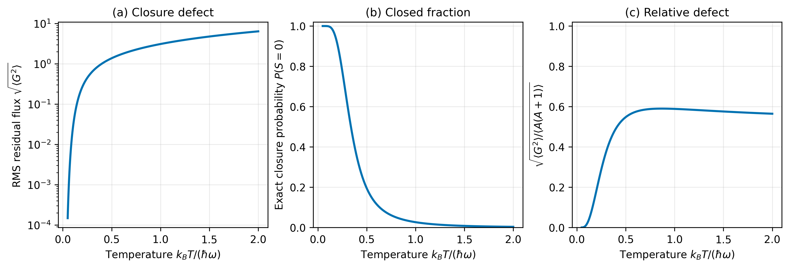
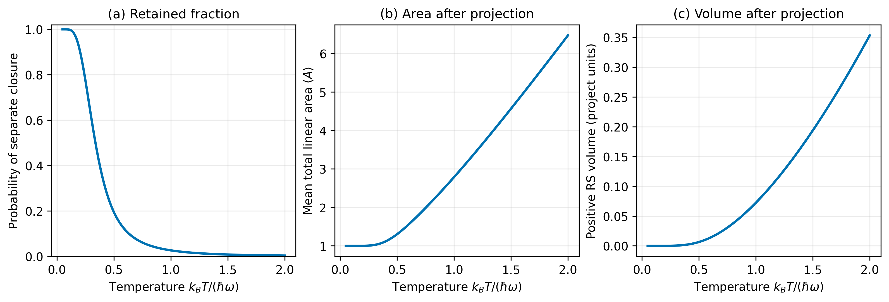
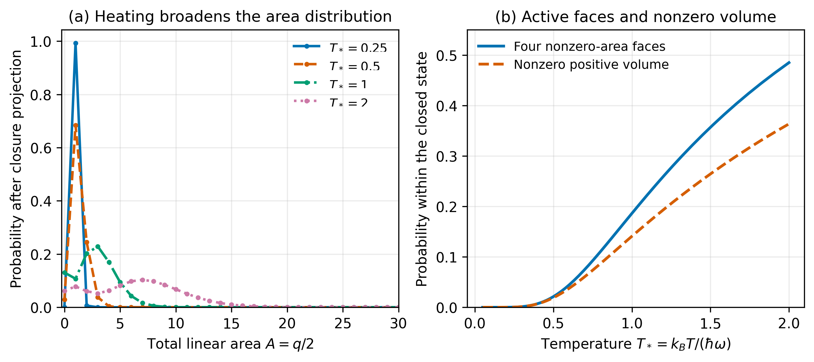
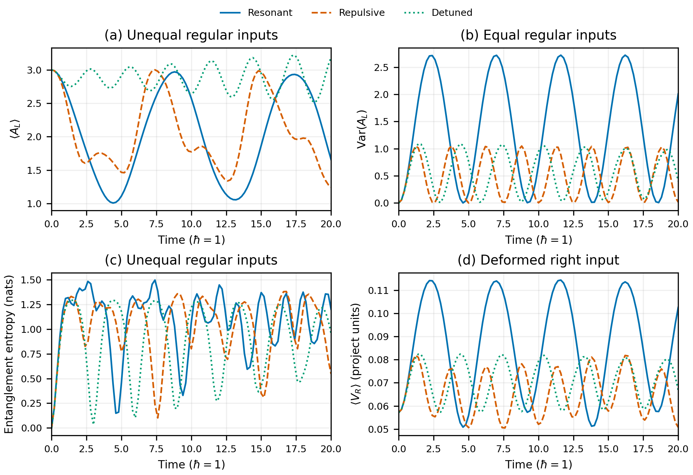

# Heating closed quantum geometry: equilibrium and singlet exchange

*Created: 2026-10-14 16:01:31 IST. Extracted from the thermal area-sector note; incorporates the October 13 heating calculations and October 14 equilibrium, manuscript, and exchange sessions.*

How can a quantum polyhedron change its area and volume while remaining closed? We have studied two approaches. The first prepares a temperature-labelled squeezed state, then selects the separately closed part. The second couples two closed FL polyhedra through singlet transfer and follows their dynamics. They answer related questions, but they are different state constructions. Their connection to thermal equilibrium must be examined explicitly.

The physical sequence is heating and closure, the geometry within the surviving closed state, the test for a Gibbs energy law, and a mechanism for exchanging area. The first sections preserve the earlier derivations and figures; the later sections explain the exchange model implemented in the subsequent session. Numerical records and reproducibility links remain beside their calculation outputs.

## Contents

- [Heating, closure, and the growth of quantum geometry](#section-16)
- [From thermal geometry to equilibrium and area exchange](#section-17)
- [The implemented two-polyhedron exchange study](#implemented-exchange)
- [What the first exchange calculation shows](#exchange-results)
- [What remains to be studied](#open-work)
- [Appendix: session records and reproducibility](#records)

## State, notation, and temperature

Each face has Schwinger modes $a_i,b_i$, spin $j_i=(n_{a_i}+n_{b_i})/2$, and angular momentum $\mathbf J_i$. The linear FL area is $A=\sum_i j_i=N_{\rm bosons}/2$. It differs from the standard LQG area proportional to $\sum_i\sqrt{j_i(j_i+1)}$. Ordinary closure requires $G^a|\psi\rangle=0$ for each component of $G=\sum_i\mathbf J_i$. Use $\boldsymbol G_L=G_L\otimes I_R$ and $\boldsymbol G_R=I_L\otimes G_R$ for the doubled-space operators.

The selected preparation is

$$
|\Psi_\beta\rangle=U_\beta\bigl(|J_{\rm in},z\rangle_L\otimes|\overline{J_{\rm in},z}\rangle_R\bigr),\qquad
U_\beta=e^{\theta(K_+-K_-)},
$$

$$
K_+=\sum_{i=1}^{4}(a_{iL}^{\dagger}a_{iR}^{\dagger}+b_{iL}^{\dagger}b_{iR}^{\dagger}),\qquad
K_-=K_+^{\dagger},\qquad \tanh\theta=e^{-b/2},
$$

with $b=\beta\hbar\omega$ and $T_*=k_BT/(\hbar\omega)=1/b$. The right factor is conjugated for this construction. The squeeze parameter labels preparations; it does not itself demonstrate equilibrium for the excited projected input. The [area-sector note](thermal-area-sectors.md#section-04) contains the occupation expansion and coefficient construction.

In the heating study $J_{\rm in}$ is the historical name for initial linear area, $q$ is final boson number per copy, $K=q/2$ is final linear area, and $S$ is ordinary resultant spin. In the exchange study below $K=A_L+A_R$ instead denotes the fixed combined linear area; local areas are $K_L,K_R$. These conventions are stated where used.

## Heating, closure, and the growth of quantum geometry

*Results and physical discussion recorded on 2026-10-13.*

What happens to a quantum polyhedron when we increase its temperature? One might expect its face areas and volume to fluctuate more strongly, while its faces continue to form a closed object. The two requirements are logically distinct. An increase in geometric fluctuations need not destroy closure, and satisfying a constraint on an extended system need not imply that each of its parts is closed. We can now follow these distinctions quantitatively in the [two-copy construction](thermal-area-sectors.md#section-04).

The calculation has two stages. We first measure how heating changes the ordinary closure of either copy of the squeezed state. We then project onto states which are separately closed in both copies and examine the area and positive volume of the resulting state. This produces a direct answer: separate closure can be retained at every finite temperature without removing the temperature dependence of the geometry.

### Temperature and the initial state

We use the four-face reference intertwiner already introduced in the occupation calculation,

$$
|\phi\rangle=\frac{F_{12}^{\dagger}}{\sqrt2}|0\rangle,
\qquad
|\Psi_\beta\rangle
=U_\beta\bigl(|\phi\rangle_L\otimes|\overline\phi\rangle_R\bigr).
$$

Its initial total linear area is $J_{\mathrm{in}}=1$. Faces 1 and 2 each have spin $1/2$ and are coupled to a singlet; faces 3 and 4 initially have zero area. Thus the starting point is an exactly closed, zero-volume reference in the four-face Hilbert space. It is particularly useful for asking how heating populates additional faces and produces nonzero volume. The occupation and closure results apply to the coherent orbit under the uniform-squeeze symmetry described in the [construction note](thermal-area-sectors.md#section-14-07); the volume results in this section use this explicit reference.

The thermal parameter enters through the same-mode squeeze,

$$
\tanh\theta=e^{-b/2},\qquad
b=\beta\hbar\omega,\qquad
T_*:=\frac{k_BT}{\hbar\omega}=\frac1b.
$$

The scale $\hbar\omega$ therefore fixes what we mean by temperature in the plots. Increasing $T_*$ strengthens the pair excitation and gives greater weight to higher occupation sectors. We continue to use $q$ for the final boson number in either copy and

$$
A:=\frac q2=\sum_{i=1}^4 j_i
$$

for its total linear area in spin units. The area $A$ can change even though the initial area label $J_{\mathrm{in}}$ is held fixed. All volume values below use the positive RS prescription and the existing project units, with $\gamma=0.2375$ and $\hbar=1$.

### Measuring how much a copy fails to close

For an ordinary single-copy intertwiner, closure means that the total face flux annihilates the state. On the doubled space the individual operators must act on their respective tensor factors:

$$
\mathbf G_L=\sum_i\mathbf J_{iL},\qquad
\mathbf G_R=\sum_i\mathbf J_{iR},
$$

$$
(\mathbf G_L\otimes I_R)|\Psi\rangle=0,
\qquad
(I_L\otimes\mathbf G_R)|\Psi\rangle=0.
$$

This is stronger than asking the mean flux to vanish. A rotationally invariant mixed state can have $\langle\mathbf G\rangle=0$ while containing components of nonzero total spin. Those components have a residual flux whose direction averages away. To measure its size, rather than its mean direction, we calculate

$$
D_\beta:=\operatorname{Tr}(\rho_L\mathbf G_L^2)
=\sum_{q,S}S(S+1)P_\beta(q,S),
\qquad
\rho_L=\operatorname{Tr}_R|\Psi_\beta\rangle\langle\Psi_\beta|.
$$

The quantity $\sqrt{D_\beta}$ is the RMS closure defect, expressed in units of $\hbar$. A complementary measure is

$$
P_{0,\beta}:=\sum_{q\ \mathrm{even}}P_\beta(q,S=0),
$$

which tells us what fraction of the state is exactly closed. The first measure asks how large the residual is; the second asks how much singlet support remains.

**Table 1. Ordinary closure of either copy before separate projection.** The two copies give identical values. Temperature is $T_*=k_BT/(\hbar\omega)$.

| $T_*$ | RMS closure defect $\sqrt{D_\beta}$ | Exactly closed fraction $P_{0,\beta}$ |
|---:|---:|---:|
| 0.125 | 0.05937 | 99.5316% |
| 0.25 | 0.44672 | 77.7501% |
| 0.5 | 1.37865 | 19.5317% |
| 1 | 3.10919 | 2.64065% |
| 2 | 6.41372 | 0.34037% |

The effect is clear. Heating increases the residual flux in each ordinary copy and reduces its singlet fraction. At zero temperature we recover the closed input, with $D_\beta=0$ and $P_{0,\beta}=1$.

**Figure 1.** Ordinary closure before projection. Panel (a) shows the growing RMS residual on a logarithmic vertical axis; panel (b) shows the decreasing probability of exact closure. Panel (c) divides the defect by the available total-spin scale, displaying $\sqrt{\langle\mathbf G^2\rangle/\langle A(A+1)\rangle}$. This relative measure peaks near $T_*=0.87$ and then decreases slightly, while the absolute residual continues to grow. The decrease reflects the growth of area, rather than a recovery of exact closure. [Vector PDF](../figures/thermal-closure-temperature/closure_temperature.pdf).

The full state nevertheless obeys the combined constraint

$$
\bigl(\mathbf G_L\otimes I_R
-I_L\otimes\overline{\mathbf G}_R\bigr)|\Psi_\beta\rangle=0.
$$

Here the bar indicates the conjugate right-copy representation. The squeeze preserves this combined generator. Its correlations compensate the ordinary closure residual of either copy. Likewise, conjugating the individual Gauss operators with $U_\beta$ preserves the transformed constraints. These are exact statements about the doubled construction. To obtain two polyhedra which are closed with respect to the ordinary fluxes, we must additionally select the separate singlet sectors.

### Imposing separate closure without freezing the geometry

Let $P_{X,0}$ project onto total spin zero in copy $X$. The appropriate operator for imposing closure on both copies is a tensor product of these projectors:

$$
\mathcal P_0=P_{L,0}\otimes P_{R,0}.
$$

We form the normalized state

$$
|\Psi_\beta^{\mathrm{closed}}\rangle
=\frac{\mathcal P_0|\Psi_\beta\rangle}{\sqrt{p_\beta}},
\qquad
p_\beta=\langle\Psi_\beta|\mathcal P_0|\Psi_\beta\rangle.
$$

Every component of this state is an ordinary singlet in both copies. Consequently both separate Gauss constraints vanish exactly. Notice what has and has not been fixed: total resultant spin is zero, but the area is still allowed to fluctuate. Closure restricts how the face angular momenta combine; it does not require their magnitudes to remain fixed.

One might expect projecting two copies to retain the square of the single-copy singlet probability. This would be the answer for independent copies. The squeezed state is correlated. In an occupation sector its coefficient matrix obeys

$$
G^a C_q=C_qG^a,
$$

so it connects equal resultant-spin representations on the two sides. If the left copy is a singlet, the right copy is a singlet as well. It follows that

$$
p_\beta=P_{0,\beta},
$$

rather than $P_{0,\beta}^2$. Direct double projection of the small-sector coefficient matrices verifies this equality.

The projected state exists at every finite temperature. For $b>0$, its vacuum-vacuum sector alone has positive squared norm $(1-e^{-b})^8e^{-2b}$, so the projected norm cannot vanish. At zero temperature the full input is already closed and $p_\beta\to1$.

### What heating does to the closed state

After projection, the area probability is simply the normalized singlet weight,

$$
\mathcal P_\beta(A)
=\frac{P_\beta(q=2A,S=0)}{p_\beta}.
$$

The positive volume is calculated on the same closed support,

$$
\langle V_{\mathrm{RS}}\rangle_{\mathrm{closed}}
=\frac{\langle\Psi_\beta|\mathcal P_0
(V_{\mathrm{RS},L}\otimes I_R)
\mathcal P_0|\Psi_\beta\rangle}{p_\beta}.
$$

There is no signed-mean substitution in this expression: $V_{\mathrm{RS}}$ is the positive operator obtained by summing the four $\sqrt{|q_{ijk}|}$ contributions. Its spectrum and kernel determine the mean volume and the probability of nonzero volume separately.

**Table 2. Geometry after imposing separate closure.** All entries refer to the normalized projected state. The area standard deviation makes the increasing spread explicit; the retained fraction refers to the original unprojected state.

| $T_*$ | Retained fraction $p_\beta$ | Mean area $\langle A\rangle$ | Area standard deviation | Mean positive RS volume |
|---:|---:|---:|---:|---:|
| 0.125 | 99.5316% | 1.000002 | 0.00150 | $3.43\times10^{-8}$ |
| 0.25 | 77.7501% | 1.006029 | 0.08229 | 0.0001025 |
| 0.5 | 19.5317% | 1.302780 | 0.60889 | 0.0064133 |
| 1 | 2.64065% | 2.787747 | 1.78945 | 0.0723452 |
| 2 | 0.34037% | 6.475739 | 3.94105 | 0.3535060 |

The constraint has not removed the response to heating. The projected state occupies successively larger area sectors, its area distribution broadens, and its positive mean volume increases. The declining retained fraction and the growing geometry describe different aspects of the same calculation: heating places more of the original state outside separate singlet support, while the normalized part which remains closed expands in area and volume.

**Figure 2.** Separate closure and geometric growth. Panel (a) shows the fraction retained by double-singlet projection. Panels (b) and (c) show the ordinary area and positive RS volume within the normalized projected state. Exact closure holds throughout all three curves. The area is measured in spin units and the volume in the stated RS project units. [Vector PDF](../figures/thermal-closed-projection/closed_projection_temperature.pdf).

A closed state need not have four active faces or a nonzero volume. The initial two-face singlet illustrates this immediately. We therefore also ask how much of the heated, projected state occupies four nonzero-area faces, and how much lies outside the positive-volume kernel. These are measured probabilities, rather than shape labels inferred from a mean volume.

**Figure 3.** The geometric content of the closed state. Panel (a) shows the area probability after projection: the initially concentrated distribution spreads to larger areas as temperature rises. Curves join discrete integer-area probabilities, with markers at the actual sectors. Panel (b) shows the probabilities of four active faces and nonzero positive volume, both conditional on separate closure. At $T_*=1$ these probabilities are 18.61% and 14.08%; at $T_*=2$ they are 48.48% and 36.34%. Heating thus populates closed configurations with additional active faces and nonzero volume. [Vector PDF](../figures/thermal-closed-projection/closed_projection_distributions.pdf).

### The high-temperature area law

The nearly straight area curve suggests a simple question: is there a definite proportionality between area and temperature? On the plotted interval $1\le T_*\le2$, a fit on 1,001 uniformly spaced temperatures gives

$$
\langle A\rangle_{\mathrm{closed}}
\simeq3.70213\,T_*-0.96406.
$$

The coefficient of determination is $R^2=0.999686$. This is an interval fit with an offset. To determine the limiting proportionality constant, we can instead use the exact singlet-sector sums.

Write $K$ for a particular final integer area, and couple faces 1 and 2 to spin $s$, with faces 3 and 4 coupled to the same spin so that the total state is a singlet. We can parameterize the occupations of the two groups as $2s+2r$ and $2s+2l$, where $r,l\ge0$ and $r+l\le K$. Then

$$
2s=K-r-l,\qquad
f=r(K-l+1),\qquad
a=K+r-l.
$$

Here $f$ is the eigenvalue of $F_{12}^\dagger F_{12}$, $a$ is the occupation of the first pair of faces, and the multiplicity is $(2s+1)^2=(K-r-l+1)^2$. The squared coefficient is built from the six terms $f^2,a^2,1,fa,f,a$. Summing them with this multiplicity produces finite polynomials in $K$. Thus the large-area behavior is available analytically, rather than inferred by extending a truncated numerical distribution to arbitrarily high temperature.

There are two sums to consider. The first is the total retained probability $p_\beta$. The second is the unnormalized area moment

$$
R_\beta:=\sum_{K=0}^{\infty}K\,P_\beta(q=2K,S=0),
\qquad
\langle A\rangle_{\mathrm{closed}}=\frac{R_\beta}{p_\beta}.
$$

At high temperature, $b=1/T_*\to0$. The sector weights contain $e^{-2bK}$, and their leading polynomial sums can be evaluated using

$$
\sum_{K=0}^{\infty}K^d e^{-2bK}
\sim\frac{d!}{(2b)^{d+1}}.
$$

Combining the six contributions gives

$$
p_\beta\sim\frac7{256}b^3,
\qquad
R_\beta\sim\frac{57}{512}b^2.
$$

Dividing the two expressions yields the area law

$$
\boxed{\langle A\rangle_{\mathrm{closed}}
\sim\frac{57}{14}\,T_*
=4.07142857\,\frac{k_BT}{\hbar\omega}.}
$$

The same calculation explains why the retained fraction becomes small at high temperature: $p_\beta$ decreases as $T_*^{-3}$, while the area of the normalized closed state grows as $T_*$. These behaviors are consistent because they concern the probability of obtaining the closed state and the geometry within that state, respectively.

The volume curve is more curved than the area curve. Its linear fit on the same interval is $\langle V_{\mathrm{RS}}\rangle\simeq0.282623T_*-0.223775$, but its local slope rises from 0.196 at $T_*=1$ to 0.351 at $T_*=2$. The data therefore establish increasing positive volume without assigning it a constant linear high-temperature coefficient. Detailed fit statistics and the symbolic finite sums are in the [fit report](../results/thermal-closed-projection/temperature_fit.json).

### Physical interpretation and the relation to Hawking temperature

The central physical effect is occupation of higher-area sectors. The squeeze creates matched excitations in the two copies. Separate singlet projection removes the components which fail ordinary closure, while retaining closed superpositions over changing face areas. As heating strengthens the excitation, the surviving closed state acquires larger mean area, larger area fluctuations, and positive volume. Exact gauge closure and thermal changes in geometry are therefore compatible in this construction.

It is useful to compare this result with a familiar relation. For a Schwarzschild black hole, the Hawking temperature measured at infinity and horizon area obey

$$
T_H=\frac{\hbar c}{2k_B\sqrt{\pi A_H}},
\qquad
A_H=\frac{\hbar^2c^2}{4\pi k_B^2T_H^2}.
$$

The horizon becomes hotter as its area decreases. In the present calculation, by contrast, $T_*$ measures excitation relative to a fixed oscillator scale $\hbar\omega$, and heating increases the occupation-derived area. This identifies the meaning of the observed growth: it is the response of the constrained oscillator geometry to increased excitation. Relating that parameter to a horizon temperature would require specifying how the excitation scale is tied to the horizon's gravitational energy and surface gravity. The Schwarzschild relation itself is reviewed in [Hawking radiation](https://www.scholarpedia.org/article/Hawking_radiation).

### Numerical checks and source of the figures

The ordinary-closure sweep covers 125 temperatures; the separately closed geometry calculation covers 85. The latter uses occupation probabilities through $q=160$ and positive-volume traces through final area $A=50$. Magnetic counting and explicit group-spin coupling agree on the projected probabilities. Direct double projection verifies both Gauss constraints and the equality of single- and double-singlet probabilities in independently constructed small sectors. Volume traces are checked against the saved closed-basis catalogue through $A=12$, and kernel probabilities against 148 archived grasp blocks. The largest bound on the omitted conditional mean-volume contribution is $5.4\times10^{-12}$.

The calculations and verification details are collected in the [ordinary-closure report](../results/thermal-closure-temperature/README.md) and [closed-projection report](../results/thermal-closed-projection/README.md). Their tables retain full precision and their figures are available as vector PDFs and 300-dpi PNGs. The drivers live in `code/thermal/`; reusable projected-volume routines live in `code/python/lqg_scattering/thermal_projection.py`. This keeps the scientific narrative here and the full numerical records beside the reproducible calculation.

## From thermal geometry to equilibrium and area exchange

*Discussion recorded: 2026-10-14 08:43:32 IST.*

We now have a family of states whose components are closed quantum polyhedra and whose area and volume change with temperature. What statistical mechanics can we extract from this construction? The first step is to examine one copy. The second is to ask what energy law, if any, makes its distribution an equilibrium distribution. These questions lead naturally to a third: how can a polyhedron exchange geometric quanta while remaining closed?

### Observables of one heated polyhedron

The doubled state is pure. A measurement confined to the left copy is described by its reduced density matrix,

$$
\rho_L^{\mathrm{closed}}(T)
=\operatorname{Tr}_R|\Psi_T^{\mathrm{closed}}\rangle
\langle\Psi_T^{\mathrm{closed}}|.
$$

For an observable $O$, its mean and variance are

$$
\langle O\rangle_T=\operatorname{Tr}(\rho_L^{\mathrm{closed}}O),
\qquad
(\Delta O)^2_T=\langle O^2\rangle_T-\langle O\rangle_T^2.
$$

We can therefore calculate area and volume distributions, correlations between faces, and the entropy $S=-k_B\operatorname{Tr}(\rho_L^{\mathrm{closed}}\log\rho_L^{\mathrm{closed}})$. We can also differentiate their means with respect to the temperature parameter. The previous section already gives several of these geometric observables.

To turn an energy fluctuation into a heat capacity, however, we need an energy operator and an equilibrium prescription. A derivative such as $d\langle A\rangle/dT$ measures the response of area; calling it a heat capacity would additionally require a specified relation between area and energy.

### What Gibbs equilibrium adds

A Gibbs state describes equilibrium under a specified Hamiltonian:

$$
\rho_\beta=\frac{e^{-\beta H}}{Z_\beta},
\qquad Z_\beta=\operatorname{Tr}e^{-\beta H},
\qquad \beta=(k_BT)^{-1}.
$$

Its energy eigenstates have Boltzmann weights. Heating changes the occupation of the energy levels of the same system. Equivalently, the Gibbs state maximizes entropy at a prescribed mean energy. The partition function then supplies internal energy, free energy, and equilibrium response relations, including

$$
U=\langle H\rangle_\beta,
\qquad \mathcal F=-k_BT\log Z_\beta,
\qquad
C=\frac{dU}{dT}=\frac{(\Delta H)^2_\beta}{k_BT^2}.
$$

For our polyhedron, this would connect the occupation of different geometries to their energy costs. The oscillator relation $\tanh\theta=e^{-\beta\hbar\omega/2}$ specifies the temperature parameter used to prepare the squeezed state. It does not by itself establish a Gibbs description of the excited, separately projected FL state. The canonical construction and its thermodynamic identities are reviewed in [David Tong's statistical mechanics notes](https://www.damtp.cam.ac.uk/user/tong/statphys/statmechhtml/S1.html).

### Reconstructing an energy law from the state

Suppose a family of density matrices is Gibbsian for one temperature-independent $H$. In an energy eigenbasis its eigenvalues obey

$$
\log\frac{p_n(\beta)}{p_m(\beta)}
=-\beta(E_n-E_m).
$$

The normalization disappears in the ratio. Thus an energy gap can be read directly from the slope of the logarithmic probability ratio. The eigenvectors must be compatible with a common energy basis, and the inferred gaps must be independent of temperature. In particular, the ordering of two energy populations cannot reverse at positive temperature.

This gives a direct test of the reference used in our projected-geometry plots. Its coefficient matrix, already derived in [the occupation calculation](thermal-area-sectors.md#section-12-01), is diagonal in a fixed singlet recoupling basis. Set $x=e^{-b}$, $b=\beta\hbar\omega$, and $\eta=1-x$. In the closed sector of final area $K$, it has the form

$$
C_K=\eta^4e^{-b(K-1)}
\left[uX+v n_{12}+wI\right],
\qquad
X=F_{12}^{\dagger}F_{12},
\qquad n_{12}=n_1+n_2,
$$

$$
u=\frac{\eta^2}{2},\qquad
v=-\frac{\eta x}{2},\qquad w=x^2.
$$

The operators in brackets commute and admit that common basis. The reduced eigenvalues are the squared coefficient eigenvalues divided by the retained probability $p_\beta$.

Consider the vacuum and the original reference $|\phi\rangle=F_{12}^{\dagger}|0\rangle/\sqrt2$. The vacuum has $K=0$, $X=0$, and $n_{12}=0$, so its coefficient is

$$
c_{\mathrm{vac}}=\eta^4x.
$$

The reference has $K=1$, $X=2$, and $n_{12}=2$. Its coefficient is

$$
c_\phi=\eta^4(2u+2v+w)
=\eta^4(1-3x+3x^2).
$$

Both are eigenvectors at every temperature. Their reduced-state probability ratio is therefore

$$
\boxed{\frac{p_{\mathrm{vac}}}{p_\phi}
=\frac{x^2}{(1-3x+3x^2)^2}.}
$$

At low temperature, $x\to0$, this ratio approaches $e^{-2b}$. A fixed Gibbs Hamiltonian would assign the vacuum an energy $2\hbar\omega$ above the reference. Yet at $x=1/2$, or $T_*=1/\log2$, the ratio is 4: the vacuum is four times more probable than the reference. No fixed energy gap can give both behaviors. The factor produced by interference in the excited-state coefficients changes the relative preferences as temperature rises.

This rules out a temperature-independent single-copy canonical Hamiltonian for the separately closed $J_{\mathrm{in}}=1$ reference family at the stated temperature. The argument uses individual density-matrix eigenvalues, not total area-sector probabilities, which include degeneracies. It is an analytic deduction from the existing coefficient formula; it does not require computing the complete entropy or a new numerical sweep.

At any one temperature we can still write, on the occupied support,

$$
H_{\mathrm{eff}}(T)=-k_BT\log\rho_L^{\mathrm{closed}}(T)+c(T)I.
$$

Here $c(T)$ fixes an arbitrary energy zero. This operator records the preferences of that prepared state. The ratio above shows why those preferences cannot be represented by one fixed $H$. This does not exclude an equilibrium description of a larger interacting system whose reduced state has a temperature-dependent effective energy operator.

### Fixed area, changing volume, and heating

The T11 hopping-plus-repulsion Hamiltonian conserves total area. Hopping redistributes quanta among faces and changes their correlations, so volume can evolve even at fixed area. The project has calculated the corresponding nonzero hopping contribution to $[H,V]$ on its tested supports. The same distinction is familiar classically: fixing the surface area does not fix the enclosed volume.

An area-conserving Hamiltonian can also have equilibrium ensembles with different mean areas at different temperatures if the ensemble spans area sectors. Heating changes their weights. Actual exchange between those sectors requires a reservoir or another system. The fixed-area T11 calculations restrict the support to one sector and therefore cannot describe the area growth plotted above. The [volume note](volume-studies.md#area-conservation-volume-dynamics-and-exchange) develops this connection.

Temperature in our present construction labels preparations. An interaction Hamiltonian would supply the additional description of how energy and geometric quanta are exchanged in time.

### Singlet exchange between closed polyhedra

The FL algebra already supplies an area-changing operation which respects closure. Its pair creator is

$$
F_{ij}^{\dagger}=a_i^{\dagger}b_j^{\dagger}
-a_j^{\dagger}b_i^{\dagger}.
$$

It creates a spin singlet across two faces. With $A=\tfrac12\sum_i n_i$,

$$
[A,F_{ij}^{\dagger}]=F_{ij}^{\dagger},
\qquad [G^a,F_{ij}^{\dagger}]=0.
$$

The first identity says that the area increases by one unit. The second says that the new state remains closed. These operators connect the fixed-area intertwiner spaces in the [Freidel–Livine construction](https://arxiv.org/html/1005.2090).

We use $G_X$ for the single-copy constraint and $\boldsymbol G_L=G_L\otimes I_R$, $\boldsymbol G_R=I_L\otimes G_R$ for its action on the doubled space. A singlet-transfer interaction would take the form

$$
H_{\mathrm{exchange}}=
\sum_{i<j}\left(g_{ij}F_{ij,L}^{\dagger}F_{ij,R}
+\overline{g}_{ij}F_{ij,R}^{\dagger}F_{ij,L}\right).
$$

One copy gains a unit of area as the other loses one. Consequently

$$
[H_{\mathrm{exchange}},A_L+A_R]=0,
\qquad
[H_{\mathrm{exchange}},\boldsymbol G_L]
=[H_{\mathrm{exchange}},\boldsymbol G_R]=0.
$$

The conservation law leaves the individual areas free to change. Closure holds throughout the exchange. The natural observables are area imbalance, area current $I_A=(i/\hbar)[H_{\mathrm{exchange}},A_L]$, singlet-pair correlations, and the resulting changes in volume.

A different interaction,

$$
H_{\mathrm{pair}}=
\sum_{i<j}\left(\lambda_{ij}F_{ij,L}^{\dagger}F_{ij,R}^{\dagger}
+\overline{\lambda}_{ij}F_{ij,R}F_{ij,L}\right),
$$

creates or removes one singlet pair in each copy. It preserves separate closure and $A_L-A_R$, while changing $A_L+A_R$. It is quartic in the elementary oscillators and gives a different preparation from the original same-mode squeeze. A driven realization would require a source of energy for the correlated excitation. These two interactions are the proposed dynamical continuation of this discussion; the numerical results above concern the existing squeeze and projection.

### Many-body systems with the same ingredients

The exchange interaction has a familiar interpretation in a Josephson junction. Cooper pairs tunnel between superconductors through a term schematically written as $-g(B_L^{\dagger}B_R+\mathrm{h.c.})$. Conventional pairs are spin singlets. In a phase description the exchange produces the Josephson energy $-E_J\cos(\varphi_L-\varphi_R)$. The corresponding question here is whether coherent singlet transfer produces an area current governed by a relative phase. [Josephson-junction lecture notes](https://scipost.org/SciPostPhysLectNotes.31).

Pair-hopping Bose–Hubbard models give a bosonic counterpart. Their terms $(c_x^{\dagger})^2c_y^2+\mathrm{h.c.}$ transfer two particles together between sites. Such models admit pair-superfluid phases, with coherence of pairs rather than ordinary single-particle coherence. Replacing the same-mode pair by $F_{ij}$ introduces the singlet structure needed for closed geometry. [Atom-pair hopping study](https://arxiv.org/abs/1208.6506).

Quantum antiferromagnets provide the closest operator match. Their Schwinger-boson singlet-bond operator is $a_i b_j-b_i a_j$, precisely $F_{ij}$ up to normalization. Antiferromagnetic bond energies can be expressed using singlet products such as $F_{ij}^{\dagger}F_{ij}$. This connects geometric correlations to singlet formation and bond rearrangement. Ordinary spin models fix the boson occupation at each site; the full intertwiner space allows those occupations, and therefore face areas, to vary. [Schwinger-boson approaches to antiferromagnetism](https://arxiv.org/abs/0809.4836).

Spin-mixing condensates make the excitation source explicit. Two atoms in a spin-1 condensate's $m=0$ component convert into a correlated $m=+1,-1$ pair through $a_+^{\dagger}a_-^{\dagger}a_0^2+\mathrm{h.c.}$. Total atom number and magnetization are conserved, while the populations change. Treating the occupied $m=0$ component as a pump produces a two-mode squeezing interaction. [Spinor-condensate parametric amplifier](https://pmc.ncbi.nlm.nih.gov/articles/PMC6513353/).

Finally, optical parametric down-conversion converts a pump photon into a signal–idler pair through $c_p c_s^{\dagger}c_i^{\dagger}+\mathrm{h.c.}$. A classical pump gives the two-mode squeeze used in our present construction. The singlet-pair creation interaction would excite composite pairs instead of individual modes. [Parametric down-conversion review](https://arxiv.org/abs/1809.00127).

The first concrete dynamical question is therefore whether singlet exchange allows a closed polyhedron to exchange area with another geometric system and approach a stationary thermal distribution. A second is whether coherent pair transfer produces oscillations and collective behavior analogous to Josephson systems and pair superfluids. These questions connect the calculated geometric observables to mechanisms already familiar in many-body physics.

## The implemented two-polyhedron exchange study

The earlier discussion supplied an interaction that respects separate closure. The next session made it a finite model and asked how its dynamics affect prepared geometry. We start with pure FL states because they give explicit input face-area proportions and shape labels. They are not identified with zero-temperature ground states: the coupled ground space is calculated separately.

### Hamiltonian and exact support

Each copy has four ordered faces. Work on

$$
\mathcal H_K=\bigoplus_{k=0}^K\mathcal H^{\rm singlet}_{4,k}\otimes\mathcal H^{\rm singlet}_{4,K-k}.
$$

Vacuum endpoints and zero-area faces are included. With $\hbar=1$,

$$
H=\epsilon_LA_L+\epsilon_RA_R+\frac{U_L}2A_L(A_L-1)+\frac{U_R}2A_R(A_R-1)
+\sum_{i<j}\left(g_{ij}F_{ij,L}^\dagger F_{ij,R}+\overline{g}_{ij}F_{ij,R}^\dagger F_{ij,L}\right).
$$

The first implementation couples identical ordered face pairs on both copies. Equal coefficients on all six pairs define the symmetric baseline; there is no division by six. Pair creators use $F_{ij}^\dagger=a_i^\dagger b_j^\dagger-a_j^\dagger b_i^\dagger$. Creation raises area by one, and transfer preserves both closure constraints and $A_L+A_R$. The current into the left copy is

$$
I_L=i[H,A_L]=i(B^\dagger-B),\qquad B=\sum_{i<j}g_{ij}F_{ij,L}^\dagger F_{ij,R}.
$$

Thus $\langle I_L\rangle=2\operatorname{Im}\langle B\rangle$ and $I_R=-I_L$. The area repulsion here is a polyhedron-level term, not T11's face-site occupation repulsion. Fixed combined area makes the implemented space finite. Extending to unrestricted area would require a separate boundedness/partition-function analysis. These copies exchange quanta; no face sewing or spatial gluing is imposed.

### Choosing classical labels

Choose outward normals and positive face-area proportions satisfying $\sum_i a_i\mathbf n_i=0$. Spinors obey $z_i^\dagger z_i=2a_i$ and $z_i^\dagger\boldsymbol\sigma z_i=2a_i\mathbf n_i$. The fixed FL label $K_X$ sets total quantum linear area; normalized spinor norms set proportions.

The pilot uses equal unit-norm face spinors on each copy. Their norm sum is four; uniform rescaling to norm sum two leaves the normalized fixed-area ket unchanged. The reusable normal-to-spinor convention is $z=(\cos(\theta/2),e^{i\varphi}\sin(\theta/2))$. The actual complex arrays are retained in the local `inputs.npz` record; the dashboard release carries the compact summary tables. Common rotations are gauge choices and are not physical orientation controls. Face-dependent spinor phases and their relation to the channel couplings must be specified when varied; a common spinor phase only changes the overall phase of a fixed-area FL state.

Use the existing closed equal-area family at $x=1/\sqrt3$: $\phi=90^\circ$ is regular, and $\phi=30^\circ$ supplies a nondegenerate deformation. Initial states are ordinary products $|K_L,z_L\rangle\otimes|K_R,z_R\rangle$. The right input is not automatically conjugated: that convention belongs to the distinct selected T9 squeeze construction.

The three preparations are regular/regular at $(2,2)$; regular/regular at $(3,1)$; and regular/deformed at $(2,2)$. At these small areas the labels are preparation data, not a claim that the state is sharply concentrated on a classical tetrahedron.

### The initial comparisons

At combined area $K=4$, the complete joint space contains 1,210 states. The local four-face singlet dimensions at areas $0,1,2,3,4$ are $1,6,20,50,105$. The direct sum includes the five area splits $(0,4),(1,3),(2,2),(3,1),(4,0)$.

| Setting | Six equal pair coefficients $g$ | $U_L=U_R$ | $\epsilon_L-\epsilon_R$ |
|---|---:|---:|---:|
| No exchange | 0 | 0 | 0 |
| Resonant | 0.1 | 0 | 0 |
| Repulsive | 0.1 | 1 | 0 |
| Detuned | 0.1 | 0 | 2 |

We set $\epsilon_R=0$ and $\hbar=1$. Each setting is applied to all three preparations. Exact energy-basis evolution gives twelve trajectories, sampled at 101 times over $0\le t\le20$. The readouts are area probabilities and variance, both mean areas, area current, weighted pair coherence, return probability, pure-state entanglement entropy, face-area means, flux-dot correlations, and positive RS volumes in repository units.

The ground states and canonical ensembles are different calculations on this same support. We use the uniform mixture over each degenerate ground space. Finite-temperature controls use $\rho_\beta=e^{-\beta H}/Z$ at $\beta=0,0.5,2,10,100$. Their temperature is measured relative to the chosen exchange-model energy scale; it is not automatically the oscillator temperature $T_*$ used in the squeezed preparation.

## What the first exchange calculation shows

For unequal regular inputs, the resonant left mean area oscillates between sampled values approximately 1.0083 and 3.0000. Detuning confines the sampled range to approximately 2.5120–3.2200 over the same time interval. These are sampled ranges, not analytic extrema or evidence of an equilibrium distribution.

For equal regular inputs, the mean areas remain equal, while the resonant left-area variance reaches approximately 2.722 and the copies become entangled. Thus equal means can conceal substantial transfer: coherent evolution populates different individual-area sectors while keeping the combined area fixed. Repulsion reduces the largest sampled equal-input variance to approximately 1.050.

**Figure 4.** Closure-preserving exchange at fixed combined area. Panel (a) follows the unequal regular input's left mean area; panel (b) follows the equal regular input's area variance; panel (c) follows the unequal regular input's entanglement entropy; panel (d) follows the deformed right input's positive RS volume. The three interacting settings are distinguished by line style and colour. Time is in the specified model units with $\hbar=1$; volume has repository normalization. [Vector PDF](../figures/t9a-singlet-exchange/exchange-overview.pdf), [curated canonical controls](../results/t9a-singlet-exchange/thermal.csv). Full time-series data remain in the local result record and are not part of the dashboard export.

All three interacting ground spaces have degeneracy 105. Resonant and repulsive ground-space mixtures have mean left area 2; the detuned ground mixture has mean left area approximately 0.0967. These results concern equilibrium energy preferences. They do not select a unique tetrahedron, and the ground mixture must not be confused with a prepared FL state or its pure-state entanglement entropy.

The pilot therefore establishes coherent area exchange, changes in geometric observables, and entanglement within an exactly separately closed finite system. It does not establish thermalization. The canonical controls give equilibrium comparisons; a reservoir calculation is needed to examine relaxation toward them.

## What remains to be studied

The next controls are larger combined areas, broader shape and channel choices, and initial states coherent across individual-area sectors. A fixed-area FL product has zero initial mean current, although transfer develops subsequently. To study a Josephson-type phase dependence, the physically relevant phase coherence must be specified rather than introduced as an overall phase of a fixed-area ket.

A reservoir extension would couple one polyhedron to several closed subsystems and examine relaxation, recurrence and dependence on the initial state. In a suitable weak-coupling large-reservoir limit, an equilibrium comparison can involve $e^{-\beta(H_L-\mu A_L)}/Z$, with an area chemical potential because combined area is conserved. That limit has not been established by the two-copy calculation.

Finally, compare reduced spectra, area distributions, entropy, volume and correlations with the squeezed-and-projected family. Its fixed single-copy Gibbs obstruction remains; an equilibrium origin in a larger interacting system requires a separate derivation. The singlet exchange study belongs to T9a under T9; T11 supplies the earlier single-copy bases, volume operators and dynamics methods. Correlated singlet creation, discussed above, remains a separate unimplemented interaction.

## Appendix: session records and reproducibility

### Manuscript work in the previous session

The previous session corrected closure equations in the [thermal-intertwiners source](../code/papers/thermal-intertwiners/thermal-intertwiners.tex): closure is a state constraint, with ordinary single-copy $G_X$ and doubled-space $\boldsymbol G_X$. It integrated the temperature/geometry results and the three heating figures above. The compiled [15-page PDF](../paper/thermal-intertwiners/thermal-intertwiners.pdf) contains them as Figures 9–11; pages 11–12 were visually inspected. The later equilibrium and exchange discussion remains in research notes rather than that manuscript.

### Exchange verification and artifacts

An analytic one-unit control gives $\langle A_L(t)\rangle=\cos^2(2|g|t)$ for equal area energies and all six equal exchange channels. Direct joint-occupation transfer independently checks matrix elements and absence of leakage from separate closure. All 46 Python tests passed. Independent sparse propagation checks 48 sampled states and all their readouts, supplemented by exact infinite-temperature traces: 1,792 comparisons with maximum residual $9.06\times10^{-13}$ against tolerance $2\times10^{-10}$. Maximum internal pilot residual is $4.53\times10^{-14}$.

The [exchange result report](../results/t9a-singlet-exchange/README.md) contains reproduction commands, runtime/source provenance and artifact descriptions. Numerical protocols stay there rather than being repeated throughout this physical narrative. The [T9a specification](t9a-singlet-exchange.md) retains the task's implementation plan and remaining stages.

### Source sessions

- [October 13 closure and projected geometry](../memory-bank/sessions/2026-10-13-t9-thermal-closure-and-geometry.md).
- [October 14 manuscript, equilibrium and many-body connections](../memory-bank/sessions/2026-10-14-t9-manuscript-and-equilibrium.md).
- [October 14 singlet-exchange implementation](../memory-bank/sessions/2026-10-14-t9a-singlet-exchange.md).

The extraction preserves the original heating/equilibrium prose and its attribution through those records. The same-mode squeeze, postselection, and Hamiltonian exchange remain explicitly distinct. This document reuses existing figures and calculations; it introduces no new numerical result.
