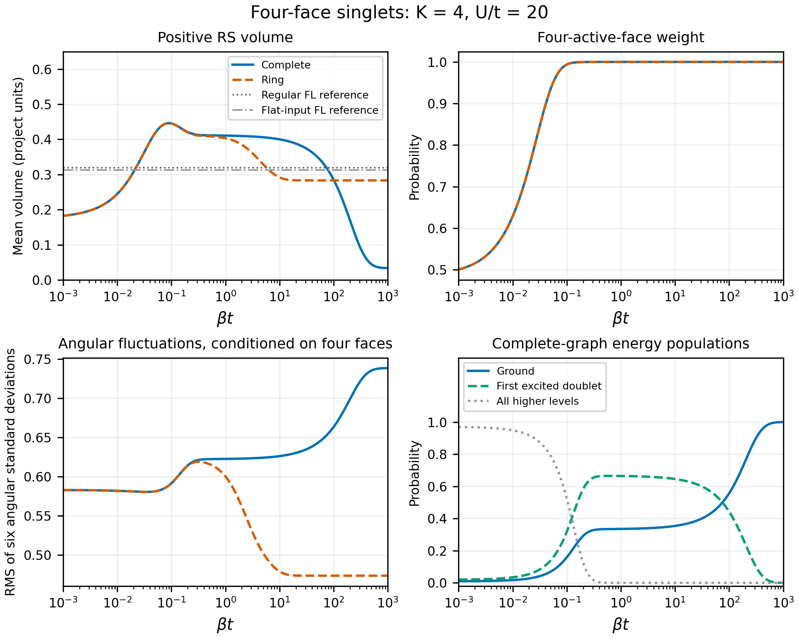

# T11: tetrahedral references and the volume crossover

This implements [the recorded plan](../../notes/t11-geometric-interpretation.md)
without changing the Hamiltonian or the saved pilot. The five-site study,
constructive sewing and two-copy T9 work remain separate.

## State comparison

All rows have $K=4$. Energy states use $t=1,U=20,g=0$; degenerate groups are
uniform mixtures. Angular fluctuations below are the root mean square of
the standard deviations of the six normalized pair-dot operators,
conditioned on four nonzero faces. Volume is the full-state positive RS
mean in project units.

| State | Four-face probability | Mean volume | $P(V=0)$ | Angular RMS standard deviation |
|---|---:|---:|---:|---:|
| Regular-input FL | 0.754630 | 0.318938 | 0.356481 | 0.557147 |
| Flat-input FL control | 0.759452 | 0.312997 | 0.361690 | 0.473718 |
| Complete ground | 0.999934 | 0.033487 | 0.931544 | 0.738410 |
| Complete first excited doublet | 0.999878 | 0.601103 | 0.000203 | 0.554715 |
| Ring ground | 0.999906 | 0.283172 | 0.521863 | 0.473245 |
| Ring first excited group | 0.999972 | 0.602824 | 0.000028 | 0.544383 |

The regular and flat inputs are labels for the specified FL preparations,
not declarations of sharply defined finite-$K$ quantum shapes. The exact
flat input is a degenerate-boundary control, not a nondegenerate tetrahedron.

## What explains the complete-graph drop?

It is not mainly face disappearance. The ground and first excited groups
both have nearly unit four-face weight, with almost identical probability
for the dominant $j_i=1$ assignment: 0.931429 and 0.932435.

Within that same assignment:

| Readout | Ground | First excited doublet |
|---|---:|---:|
| Mean volume | zero within numerical tolerance | 0.609306 |
| Zero-volume probability | 1 | zero within numerical tolerance |
| All six angular means | $-1/3$ | $-1/3$ |
| Each angular standard deviation | 0.745356 | 0.552771 |
| Overlap with same-area regular FL reference | zero within numerical tolerance | 0.5 |
| Overlap with same-area flat-input FL reference | 0.444444 | 0.277778 |

The ground sector is one-dimensional, in the volume kernel; the excited
conditional support is two-dimensional. The overlap of 0.5 with its uniform
mixture is not an exclusive probability for a regular shape. Mean angular
correlations alone would suggest identical regular-looking face angles,
while the volume and fluctuations are very different.

Ground overlap with the same-area FL path increases as the input flattens,
but the overlap is only 0.444444 at the boundary. The flat-input reference
itself has finite positive volume at this $K$. These data support quantum
volume suppression and broad angular fluctuations, with a connection to
flattening references; they do not establish one sharply flattened
classical tetrahedron. This one labelled equal-input-area path does not
exhaust tetrahedral shapes, area partitions, permutations or opposite
orientations.

The ring ground state's same-area opposite-face means are approximately
$-0.999972$, with standard deviation 0.00649. Adjacent pair means are near
zero with standard deviation 0.57875. This is an anisotropic quantum
correlation pattern; a reconstruction from its means is not proof of a
single classical tetrahedron.

## Thermal interpretation

The entire exact spectrum, not only the three displayed groups, enters
the Gibbs calculations. The previously calculated volume curve is
reproduced. As the complete graph approaches its ground state, the excited
doublet population decreases, positive volume falls, four-face weight stays
almost one, and angular fluctuations increase. This explains the crossover
in terms of states without changing the equilibrium ensemble or assuming
that an FL preparation is its thermal state.

## Observables and normalization

Saved angular matrices use

$$D_{ij}=\mathbf J_i\cdot\mathbf J_j,\qquad
C_{ij}=\frac{D_{ij}}{\sqrt{j_i(j_i+1)j_j(j_j+1)}}.$$

The denominator is evaluated separately in each local-spin assignment.
Angles are conditioned on four nonzero faces; no angle is assigned to a
missing face. Conditional states use $P\rho P/\operatorname{Tr}(P\rho)$,
preserving coherence inside the selected space. `state_details.json`
contains full symmetrized angular covariance matrices and face-area
covariances. `area_sectors.csv` retains assignment probabilities and their
conditional pair means/standard deviations, volumes and signed-grasp moments.

Volume uses all four connected triples and the established project
normalization. `geometric_volume_mean` applies the T5c factor $\sqrt2/12$;
`reference_inputs.json` compares with the classical input face vectors
$\gamma(K/4)n_i$ in the same convention. This geometric conversion is
distinct from unselected physical regularization and Planck-unit factors.
No factor was fitted to these results.

Signed grasp means are also saved: a zero signed mean alone does not imply
zero positive volume. Tiny negative probabilities/overlaps or volume
expectations at order $10^{-16}$ are floating-point residuals, retained in
raw files and interpreted as zero within the stated tolerance.

## Verification and reproduction

The frozen tolerance is $2\times10^{-10}$. Largest independent residual:
$5.14\times10^{-12}$ for the matrix-exponential Gibbs control. Saved thermal
volume parity is within $4.42\times10^{-13}$. Operator, closure, conditional
trace and overlap controls agree at approximately $10^{-15}$ or better.
All 42 Python tests pass, including exact two-spin-half-singlet angular
means/variances, coherence-preserving conditioning, sector normalization,
and covariance for noncommuting operators.

Validation uses independently assembled magnetic ladder pair dots,
epsilon-contracted triples, positive-root reconstruction, explicit sliced
traces, rotated bases in degenerate groups, and direct matrix exponentials.
It shares the archived singlet basis; this is not a completely independent
implementation or a new Rust validation. Source hashes include the shared
Python package. The source driver records the study-note hash as it existed
when the run completed; `source_hashes.json` records the final note and code.

From the repository root, using the `qc-diff` Python environment and
`OPENBLAS_NUM_THREADS=1 OMP_NUM_THREADS=1 PYTHONPATH=code/python`:

1. `python code/python/t11_geometric_interpretation.py`
2. `python code/python/plot_t11_geometric_interpretation.py`
3. `python code/python/verify_t11_geometric_interpretation.py`
4. `python -m unittest discover -s code/python -p 'test_*.py'`

Redirect verbose output to temporary logs. A writable `MPLCONFIGDIR` can
avoid rebuilding the plotting font cache.

Outputs include all eleven state summaries, six-pair data, assignment and
volume distributions, reference overlaps under three conditioning choices,
reference input geometry, and 1,206 thermal rows. `states_and_operators.npz`
saves references, energy vectors and the diagnosed operators/density matrices.
`protocol.json`, `validation.json`, `independent_checks.json`,
`provenance.json`, `source_hashes.json`, and `sha256.json` provide reproducible
conventions and checks. Figures are vector PDF and 300-dpi PNG.

No phase transition, general semiclassical limit, unique classical shape,
physical volume calibration, or gravitational Hamiltonian is established.
