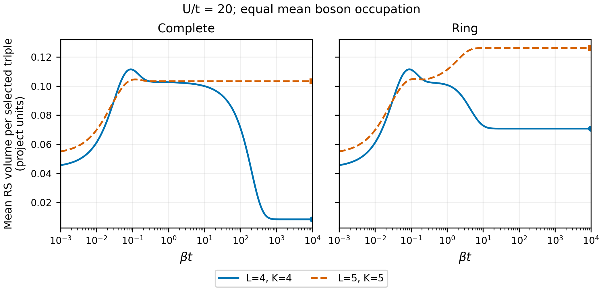

# T11: one larger-system persistence test

This extends the established four-site Hamiltonian–volume result, keeping
the two-copy T9 program and constructive edge sewing separate. Calculated
2026-10-10 against repository commit `9ef9bba`; exact commit and source
hashes are in the provenance files. No Memory Bank or dashboard update is
part of this calculation.

## Frozen comparison

The question is whether the nonmonotonic thermal volume and pronounced
complete-graph low-temperature suppression survive a larger exact singlet
system at the same mean boson occupation. Compare $(L,K)=(4,4)$ and $(5,5)$,
so $2K/L=2$. $K=\sum_i j_i$ is linear area, not the Casimir-area sum.
Empty sites are included. Singlet dimensions are 105 and 1,176. The
six-site density-matched sector has 5,292 states and was not run.

Graphs are the complete graph and periodic ring on labelled sites. Hopping
is $-t\sum_{(i,j)}(E_{ij}+E_{ji})$, with unit weight per bond; onsite cost
is $U\sum_i n_i(n_i-1)/2$. Keep $g=0$, without extra exchange or a volume
coupling. Main comparison: $t=1,U=20$. Controls: $t=1,U=0$ and $t=0,U=1$.
No degree rescaling is introduced: the complete-graph coordination changes
from three to four. The five-site ring introduces an odd cycle. These are
explicit confounders, so this is a persistence test, not finite-size scaling.

Use exact fixed-number, total-spin-zero Gibbs states, $k_B=1$, and uniform
mixtures within degenerate ground spaces. The grid contains zero, 701
logarithmic inverse temperatures $10^{-3}$ through $10^4$, and the exact
zero-temperature limit. Plot $\beta t$ for hopping cases. For the no-hopping
control report $\beta U$; $\beta/t$ is not a dimensionless temperature.
The older pilot note's $\beta/t$ label is harmless numerically at $t=1$
but should not be generalized, especially to $t=0$.

`protocol.json` was written before operator construction. Numerical
acceptance tolerance is $2\times10^{-10}$; roots retain the existing
$64\epsilon_{\rm mach}\max(1,\rho(|q|))$ kernel cutoff. Ground degeneracies
use the acceptance tolerance. The display-only energy table groups values
rounded to eight decimals; thermal sums use every unrounded eigenvalue.

## Volume normalization

Retain the project's positive RS prescription:

$$V=\gamma^{3/2}\sum_{\tau\in\mathcal T_G}\sqrt{|q_\tau|},
\qquad q_{ijk}=i[\mathbf J_i\cdot\mathbf J_j,\mathbf J_j\cdot\mathbf J_k],
\qquad \gamma=0.2375,\quad\hbar=1.$$

Include connected induced triples. Counts are four for either four-site
graph, ten for the five-site complete graph, and five for the five-site
ring. Thus the larger graph comparison changes the volume operator as well
as the Hamiltonian. Total volume and volume per selected triple are both
saved. The latter removes the elementary term-count difference; it is a
diagnostic, not volume per spatial cell or a physical volume density.

A common positive scalar calibration rescales volume means and their
derivatives, but leaves turning temperatures, fractional suppression,
zero-volume probabilities, degeneracies, and energy gaps unchanged because
this Hamiltonian has no volume term. Absolute volumes and statements in
physical units depend on calibration. Graph-dependent factors, alternate
operator prescriptions, or a volume-coupled Hamiltonian are different
models and need new calculations. No physical regularization constant,
Planck-area factor, embedding, or semiclassical geometric calibration is
selected here. These outputs are not physically calibrated volumes.

## Calculated result

At $U/t=20$:

| Sites | Graph | Ground multiplicity | Gap / $t$ | Ground volume per triple | Ground $P(V=0)$ |
|---:|---|---:|---:|---:|---:|
| 4 | Complete | 1 | 0.0092257 | 0.008372 | 0.93154 |
| 4 | Ring | 1 | 0.359870 | 0.070793 | 0.52186 |
| 5 | Complete | 6 | 12.643382 | 0.103422 | 0.0001291 |
| 5 | Ring | 1 | 0.556048 | 0.126281 | 0.00005161 |

The nonmonotonic intermediate-temperature response survives on both larger
graphs: a small local maximum is followed by a local minimum, then recovery
toward the ground-state value. `turning_points.json` resolves the extrema
by zeros of the energy–volume covariance, rather than choosing them only
from the plotting grid. The ring's largest volume is its ground-state
value, despite its earlier local maximum. The no-hopping control remains
nonmonotonic too.

The pronounced four-site complete-graph low-temperature collapse does not
persist in this comparison. Its almost gapless, nearly zero-volume ground
state is replaced by a six-dimensional, substantial-volume ground space
with a much larger gap. The five-site complete graph's first excited
singlet has *lower* mean volume (0.484899) than its ground-space mean
(1.034217). The ring's first excited doublet has mean volume 0.622398,
slightly below its ground value 0.631406. This reverses the simple
low-energy ordering responsible for the earlier collapse.

These are finite-system spectral observations. One larger sector cannot
establish universality, a thermodynamic limit, or a phase transition, nor
separate size from coordination and odd-cycle effects.

## Validation and reproducibility

Shared Python routines supply CG coefficients, sparse oscillator actions,
and positive roots. Independent controls compare CG multiplicities with
magnetic counting, test raising/lowering closure, compare commutator triples
with direct local-spin epsilon contraction, check hopping leakage, and
recover free-hopping ground energies from the two lowest one-particle
orbitals. Convex onsite minimization independently gives no-hop ground
energy $L$ at this density. No independent Rust larger-system calculation
was performed; Python/Rust remains the project direction.

Largest construction residual is $2.45\times10^{-15}$; largest eigenpair
residual is $1.03\times10^{-12}$. The four-site summary matches saved pilot
values within $7.2\times10^{-14}$. Independent log-sum-exp Gibbs weights
agree within $4.5\times10^{-16}$; covariance versus finite-difference
derivatives agree within $1.5\times10^{-7}$ (threshold $2\times10^{-6}$).
These checks validate this finite numerical calculation, not physical
calibration or the full research program.

The existing Python suite also passed all 38 tests. The exported figure was
visually inspected; labels are readable and the legend sits outside the data.

Run from the repository root with `OPENBLAS_NUM_THREADS=1`,
`OMP_NUM_THREADS=1`, `PYTHONPATH=code/python`, using the `qc-diff` Python:

1. `python code/python/t11_size_comparison.py`
2. `python code/python/plot_t11_size_comparison.py`
3. `python code/python/verify_t11_size_comparison.py`

`summary.csv`, `thermal_scan.csv`, and `energy_levels.csv` contain the
results. NPZ files save unrounded energies and energy-basis volume/zero
probabilities; the driver reconstructs operators. `validation.json` and
`independent_checks.json` record checks. `sha256.json` hashes output files.
The comparison figure is vector PDF and a 300-dpi PNG.

