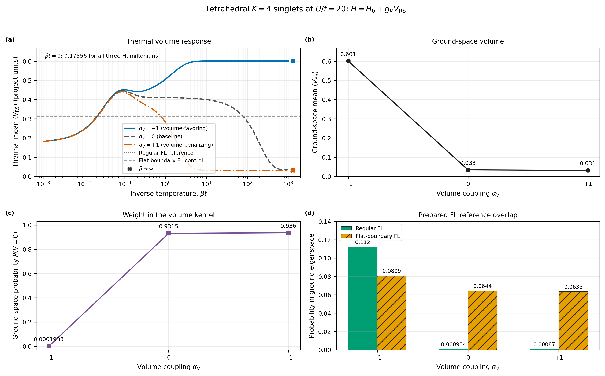

# T11: positive-volume coupling in the tetrahedral sector

This calculation tests whether an explicit positive-RS-volume term changes the four-face tetrahedral states. The hopping graph is the complete graph $K_4$, matching tetrahedral face adjacency, with equal hopping strength on its six edges. The calculation uses the full $K=4$, total-spin-zero singlet space (105 states), $t=1$, $U/t=20$, and the historical spin-exchange coefficient set to zero.

The Hamiltonian is

$$
H=H_0+g_VV_{\mathrm{RS}},\qquad
H_0=-t\sum_{i<j}(E_{ij}+E_{ji})+
\frac{U}{2}\sum_i n_i(n_i-1).
$$

Here $V_{\mathrm{RS}}$ is the same four-connected-triple positive volume operator used in the T11 pilot. Its spectral range in this sector is $\Delta V=0.609306380473$ project-volume units. The dimensionless coupling is $\alpha_V=g_V\Delta V/t$; the tested values are $-1,0,+1$, corresponding to $g_V=-1.641210451832,0,+1.641210451832$ in energy per project-volume unit. No separate physical-volume calibration is applied.

## Ground-space results

| $\alpha_V$ | $g_V$ | Ground energy | Ground degeneracy | First gap | Ground mean volume | $P(V=0)$ |
|---:|---:|---:|---:|---:|---:|---:|
| -1 | -1.641210 | 77.497011 | 2 | 0.920552 | 0.601241 | 0.000193 |
| 0 | 0 | 78.474435 | 1 | 0.009226 | 0.033487 | 0.931544 |
| +1 | +1.641210 | 78.527599 | 1 | 0.942482 | 0.031332 | 0.935951 |

Negative $g_V$ strongly favors high positive volume: the ground-space mean rises from $0.033487$ to $0.601241$, close to the sector's maximum volume eigenvalue $0.609306$, and its zero-volume probability falls below $2\times10^{-4}$. Positive $g_V$ changes the ground-space mean only modestly because the uncoupled ground state already lies mostly in the volume kernel. It does, however, increase the first gap from $0.009226$ to $0.942482$.

## Thermal results

All three Hamiltonians have the same infinite-temperature mean volume, $0.175563653$, as required because $\beta=0$ gives the uniform state independent of the Hamiltonian. At lower temperatures the responses separate:

| $\alpha_V$ | $\langle V\rangle$ at $\beta t=10$ | $P(V=0)$ at $\beta t=10$ | $\langle V\rangle$ at $\beta t=100$ | $P(V=0)$ at $\beta t=100$ |
|---:|---:|---:|---:|---:|
| -1 | 0.601213 | 0.000240 | 0.601241 | 0.000193 |
| 0 | 0.400087 | 0.330028 | 0.284881 | 0.519058 |
| +1 | 0.031424 | 0.935800 | 0.031332 | 0.935951 |

Thus the positive coupling moves the low-temperature drop to much warmer inverse temperature: at $\beta t=10$ the baseline still has mean volume $0.400087$, while the positive-coupling value is already near its ground-state limit. The negative coupling instead selects a high-volume ground space. The response is asymmetric around zero because the uncoupled spectrum already has a low-volume ground state and a very small gap.

## Prepared FL references

The normalized regular and flat-boundary $K=4$ FL references have fixed volume readouts $0.318938$ and $0.312997$ project units, respectively. Their probabilities of a zero-volume measurement are $0.356481$ and $0.361690$. Their probabilities in the candidate Hamiltonians' ground eigenspaces are:

| $\alpha_V$ | Regular FL | Flat-boundary FL |
|---:|---:|---:|
| -1 | 0.112216 | 0.080898 |
| 0 | 0.000934 | 0.064423 |
| +1 | 0.000870 | 0.063541 |

The negative coupling produces a high-volume ground space, but the regular FL reference has only $11.2\%$ probability in it. So favoring positive volume does not by itself select the regular FL state. These are full-space overlaps with the entire ground eigenspace; the negative-coupling ground state is twofold degenerate.



## Verification and reproduction

The independent verifier compared NumPy spectra with the saved eigenspectra, checked representative Gibbs readouts using direct SciPy matrix exponentials, and compared the zero-coupling ground and thermal readouts with the earlier saved T11 pilot. It also checked that saved volume-outcome distributions normalize. All 78 checks passed; the largest residual was $7.44\times10^{-13}$, below the $2\times10^{-10}$ tolerance.

From the repository root, run:

```bash
conda run -n qc-diff python code/python/t11_volume_coupling.py
conda run -n qc-diff python code/python/verify_t11_volume_coupling.py
conda run -n qc-diff python code/python/plot_t11_volume_coupling.py
```

The full 603-point thermal records, selected volume distributions, reference readouts, all energy levels, protocol, provenance, and validation files are in this directory. The vector figure is `volume_coupling_response.pdf`; the 300-dpi preview is `volume_coupling_response.png`.
